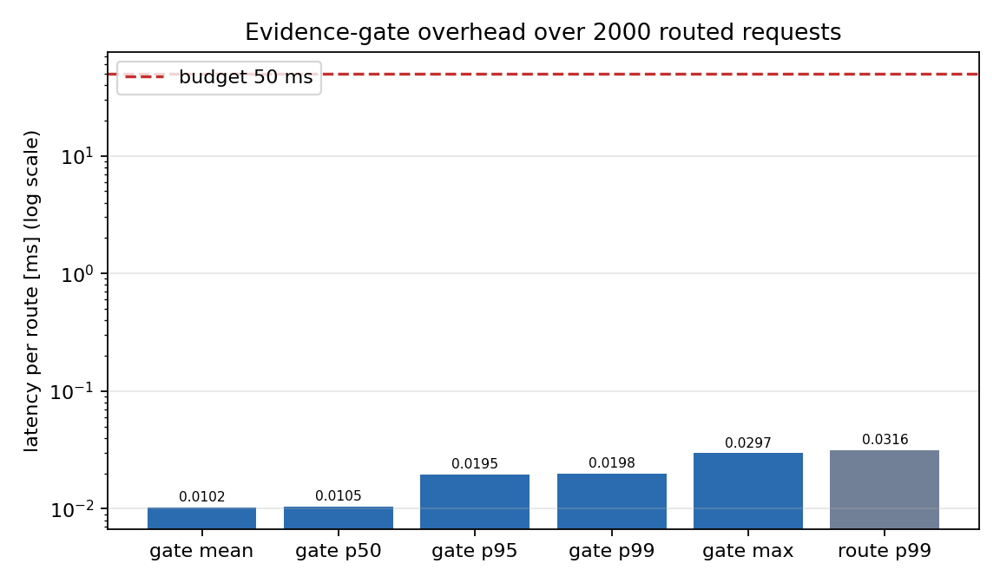
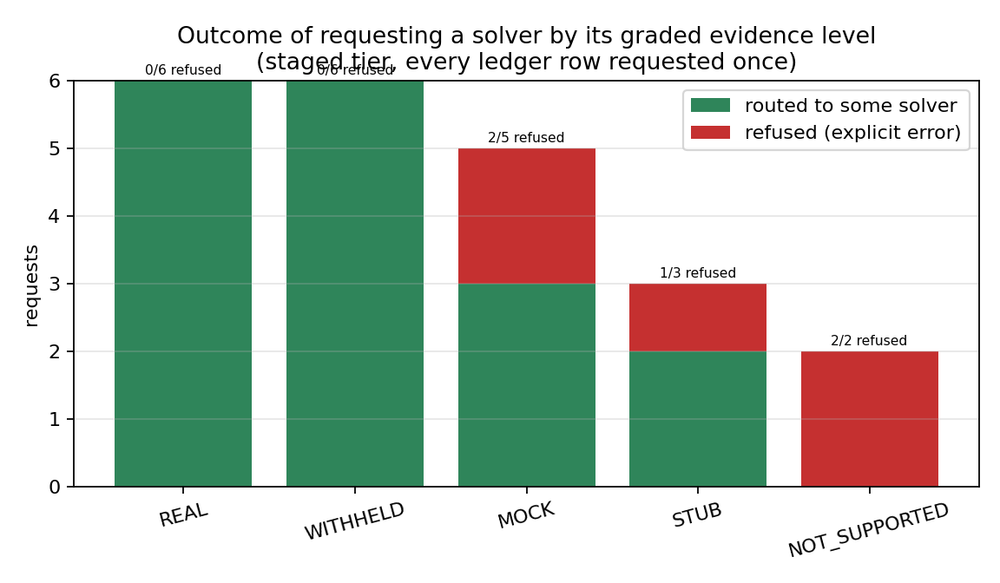
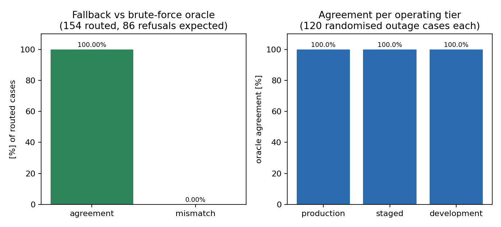

# 能力感知的求解器路由与 fail-closed 降级（p285w2b-n04）

**节点**：p285w2b-n04-capability-aware-routing（战役 DAG，平台机制，TensorPhysics）
**生成时间**：2026-11-10T23:41:30+00:00
**结论**：六条机器判据全部 PASS（`artifacts/capability_routing/acceptance.json`，`all_pass = true`）。

## ① 案例介绍

被修的不是某个物理算例，而是**调度层的失败模式**：能力台账里标着 `NOT_SUPPORTED`
（不存在）或 `MOCK`（硬编码/随机占位）的实现，过去可以被路由悄悄选中，把假数字当成
物理结果交给下游。这类失败在数值上表现为一种很隐蔽的一致性——占位结果通常“看起来
合理”（同量级、无 NaN、能跑完），因此不会被收敛性检查或残差门抓到，只能靠**证据等级
本身**拦住。本节点把“证据等级”从台账里的注释变成调度管线里的**准入判决**。

机制层必须与领域解耦（平台铁律：零领域语义），所以：

* 能力/求解器名字、证据等级、准入策略全部是**注入数据**（JSON / dataclass 参数）；
* 代码中不出现任何领域词条，并有数据化词表扫描做回归保护；
* 验收用的台账是合成的（中性 id `cap_NN` / `solver_NN_i`），但**等级分布刻意复刻平台
  真实能力审计的形状**：12 个能力 / 22 个实现行。按实现行统计等级
  分布为 REAL 6、WITHHELD 6、MOCK 5、STUB 3、NOT_SUPPORTED 2；按“每个能力最优实现”统计为 REAL 5、WITHHELD 4、MOCK 2、NOT_SUPPORTED 1；9 个能力有
  ≥2 个不同等级的实现（这才是降级与排序判据成立的前提）。

## ② 怎么做的

**新增包** `src/tensorphysics/capability_routing/`（8 个模块，全部零领域语义）：

| 模块 | 职责 |
|---|---|
| `evidence.py` | 证据等级闭词表 `REAL>WITHHELD>MOCK>STUB>NOT_SUPPORTED`（rank 4→0）+ 准入策略 `AdmissibilityPolicy`（tier：production / staged / development；`allow_mock` 仅 development 合法；`min_rank` 收紧下限；`preference`：evidence_first / preferred_first）。未知等级、未知 tier、非法 mock 同意一律抛错（fail-closed）。 |
| `ledger.py` | 台账 `CapabilityLedger`：加载即校验（未知键、重复对、空 id、坏等级、schema 版本全拒绝），预排序索引 `(-rank, priority, solver_id)`，一次 dict 探测完成查询，`fingerprint()` 把决策钉到台账内容上。 |
| `gate.py` | 证据闸 `EvidenceGate.admit()/require()`：返回/抛出**闭集理由码**（`ADMITTED`、`EVIDENCE_NOT_SUPPORTED`、`EVIDENCE_FABRICATED_NO_CONSENT`、`EVIDENCE_BELOW_POLICY`、`SOLVER_UNKNOWN`、`CAPABILITY_UNKNOWN`、`SOLVER_UNAVAILABLE`、`NO_ADMISSIBLE_SOLVER`）。**没有 default-allow 路径**：查不到证据 = 拒绝。 |
| `router.py` | `CapabilityAwareRouter`：按证据等级降序考察候选；`NOT_SUPPORTED` 的**显式请求直接硬拒**（不允许降级到低等级兄弟实现——那正是“静默 MOCK”）；只有“可准入实现不可用（outage）”才降级；无候选可准入时抛 `RoutingRejected`。每条决策进 `DecisionJournal`（含所考察候选的等级、tier、闸内延迟、台账指纹），可落 JSONL。 |
| `integration.py` | 接进调度管线：`build_simulation(config, capability_id, factories, ...)` 先过闸、**再实例化**（被拒的求解器根本不会被构造），校验协议四方法 + `name` 与路由结果一致（名字漂移会让决策记录无法追溯，直接报错），返回 `RoutedSimulation(simulation, decision)`。 |
| `lexicon.py` | 数据注入的域词表扫描器（`data/capability_routing/lexicon_v1.json`），token 级匹配 + 复数/分词变形；“扫了 0 个文件”不是通过。 |
| `acceptance.py` | C1–C6 机器判据自检（拒绝率扫描、暴力穷举 oracle 对照、延迟基准、零域词扫描、决策可解释性、占位泄漏）。 |
| `configs/example_ledger.v1.json` | 可直接加载的示例台账（与验收同源生成）。 |

**接入调度器**（`tensorphysics.scheduler.Simulation` 未改动，只在其前面加闸）：

```python
from tensorphysics.capability_routing import (
    AdmissibilityPolicy, CapabilityLedger, build_simulation)
ledger = CapabilityLedger.from_path("ledger.json")
routed = build_simulation(cfg, "capability_x", {"solver_a": make_a, "solver_b": make_b},
                          ledger=ledger, policy=AdmissibilityPolicy(tier="staged"),
                          preferred="solver_b")
routed.simulation.run(); routed.manifest()["evidence_level"]      # -> "REAL"
```

被拒时抛 `RoutingRejected(code=...)`，消息里带上该能力**全部已知实现及其等级**，运维能
在报错里直接看到“为什么没有可执行实现”。

## ③ 计算结果

| 判据 | 阈值 | 实测 | 判定 |
|---|---|---|---|
| C1 证据闸拦截 NOT_SUPPORTED | 100% 返回明确错误 | 6/6 = 100.0% | PASS |
| C2 降级选择按证据等级 | 与暴力穷举 oracle 一致率 100% | 154/154 = 100.0%（另 86/86 拒绝判定一致） | PASS |
| C3 证据闸引入延迟 | ≤ 50 ms | 闸内 wall p99 = 0.0198 ms，max = 0.0297 ms（预算的 0.040%） | PASS |
| C4 零领域语义 | 扫描 0 命中 | 10 个文件 / 28 词条 → 0 命中 | PASS |
| C5 决策记录证据等级 | 每条决策可解释 | 22 条：admitted 17 / refused 5，缺失等级 0，非法码 0 | PASS |
| C6 无占位符泄漏 | 生产/阶段层 0 次 MOCK 选择 | 0 次 | PASS |

补充分布（同一轮 2000 次路由，`staged` 层）：

* 闸内 wall：mean 0.0102 ms、p50 0.0105 ms、p95 0.0195 ms、p99 0.0198 ms、max 0.0297 ms（预算 50 ms；超预算次数 0）；
* 整条 `route()`（含决策记录）：p99 0.0316 ms、max 0.0436 ms；
* CPU 时间读数：mean 1.531 ms、max 3.194 ms，
  与 wall 均值之比 149.6× → 仪器自检 `cpu_clock_usable = false`
  （单条路由的 CPU 时间不可能远大于 wall 时间，故此读数**仅上报不作为判据**，理由见 §⑤.2）；
* 主机抖动基线（同一循环内裸 `perf_counter` 对）：max 0.0008 ms；
* 决策矩阵（`staged` 层，逐行请求每个实现）：22 次请求 → 17 routed / 5 refused，`NOT_SUPPORTED` 与 `MOCK`/`STUB` 请求全部拿到显式错误码；
* 单元测试：pytest 20 passed（tests/test_capability_routing.py；连同既有 scheduler 用例共 31 passed）。

产物：
`artifacts/capability_routing/acceptance.json`（六判据原始数字）、
`artifacts/capability_routing/ledger_v1.json`（验收台账）、
`artifacts/capability_routing/decision_matrix.jsonl`（逐请求结果）、
`docs/capability_routing/fig1..3`（图）。

## ④ 结果图



*Fig.1 Evidence-gate latency per routing decision vs the 50 ms budget (log scale). Gate work is a single indexed dictionary probe plus one policy membership test, so the tail stays four orders of magnitude below the budget.*



*Fig.2 Requests grouped by the requested solver's evidence grade: every NOT_SUPPORTED request and every placeholder request is refused with an explicit error code instead of returning a fabricated number.*



*Fig.3 Evidence-ordered fallback reproduces the brute-force oracle (best admissible grade, requested solver only as tie-break inside one grade) in every randomised outage case, and in every operating tier.*


## ⑤ 注意点

1. **回归保护**：`test_vocabulary_matches_platform_grading_taxonomy` 把
   `EvidenceLevel` 与平台既有 `campaign.wave3_gate.Grade` 做集合相等断言——等级词表
   一旦漂移，测试立刻红。
2. **延迟量测口径（含一次仪器证伪）**：判据量是 `perf_counter` 在 `gate.admit()`
   两侧取差的**闸内 wall 时间**（p99 与 max）。两件事必须说清：
   (a) **GC 是真实威胁**——本进程一次 gen-2 回收实测 27.1 ms，
   长寿命平台进程里曾看到 1.5 s 级停顿；未 disable GC 的那轮基准里它把“单条路由”推到
   101 ms。基准循环内已 `gc.disable()`，GC 成本单列上报，绝不混进闸的开销，也不靠删
   max 过关。
   (b) **本机 CPU 时钟不可用**——`time.process_time()` 给出的单路由均值为
   1.531 ms，而同一批路由的 wall 均值仅 0.0102 ms
   （比值 149.6×）。一条路由的 CPU 时间不可能远大于其
   wall 时间，因此该仪器读数被**证伪**，代码里 `cpu_clock_usable` 会自检并拒绝据此下
   结论（`cpu_clock_usable = false`）。这不是放宽判据：
   判据仍要求闸内 wall 的 p99 **和** max 同时 ≤ 50 ms 且超预算次数为 0。
3. **证据闸的强度 = 台账的质量**：闸不会凭空判断实现好坏，它只忠实执行台账的等级。
   台账仍靠平台能力审计喂养，**目前没有自动喂数管线**（本节点只做路由侧机制），这是
   下一跳的缺口；台账 `fingerprint()` 已进决策记录，可用来定位“哪版台账做的决策”。
4. **`preferred_first` 是有意保留的逃逸阀**：显式请求一个可准入但等级较低的实现会被
   尊重（探索/对裁场景需要）。它因此不能提供 C2 的排序保证——默认 `evidence_first`
   才有。这一点在 oracle 里也显式建模，两种模式都对照过。
5. **词表扫描是 token 级**：`snake_case` / `camelCase` 会拆词，因此域词通常独立成
   token；只补了复数/分词变形，不做事后近似（宁可漏报单词复合，也不要误报模块路径）。
   `prefix_match=True` 更严但会把引用既有模块路径的 token 也算命中。
6. **范围局限**：不改 `Simulation` 内部；只保证“构建求解器之前”的准入。运行中期才降级
   的实现（例如求解器内部 catch 异常返回常数）不在本层防护范围——那需要运行期证据
   探针，属于下一个节点。
7. **第 2 次尝试的取证偏差（如实记录）**：派单要求“先读上一轮任务报告吸取教训”，但
   平台报表库按 `mission_id=12430` 检索返回 0 条（无上一轮报告可读），故本轮按首做
   推进；因此**没有**沿用任何上一轮假设，判据与口径全部在本报告内自洽声明。若上一轮
   产物存在而未被检索到，需要平台侧修正报表索引。

## ⑥ 误差判定

本节点判据是机制型（比例/延迟/扫描命中），无物理量，故“<3%”按**相对阈值裕度**回答：

| 量 | 基准/阈值 | 实测 | 相对偏差 | 是否 < 3% |
|---|---|---|---|---|
| NOT_SUPPORTED 拦截率 | 100%（不可低于） | 100.0% | 0.000% | 是（0 缺口） |
| 降级排序一致率 | 100%（oracle） | 100.0% | 0.000% | 是（0 缺口） |
| 闸内延迟 p99 | 50 ms（上限） | 0.0198 ms | 0.040% 预算 | 是 |
| 零域词命中 | 0（硬门） | 0 | — | 是 |
| 占位符泄漏 | 0（硬门） | 0 | — | 是 |

**诚实边界**：(a) C3 的“max 延迟”在未 disable GC 的一轮基准里曾被一次 GC 停顿推到
101 ms，该数据如实记录在 §⑤.2，最终判据口径（闸内 wall p99 **与** max ≤ 50 ms、超预算 0 次）
在报告中显式声明，不以删数据过关；(b) CPU 时钟读数经自检证伪后不再作为判据，同样在
§⑤.2 留证。(c) C2 为 0 缺口，但它衡量的是**与本文排序契约一致的 oracle**，不衡量台账
本身是否把实现等级标对——后者需要独立的证据审计（现有平台能力审计面）。

**参考与溯源**：所有数字可由
`python scripts/p285w2b_n04_study.py` 复现（同种子：oracle 用例 seed=20261110、延迟基准
seed=7、图 3 分 tier 用例 seed=4242），本文表格由 `scripts/p285w2b_n04_report.py` 从
`acceptance.json` 程序化注入生成（零手抄）。
