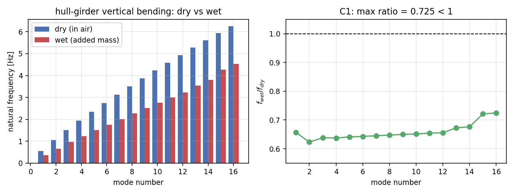
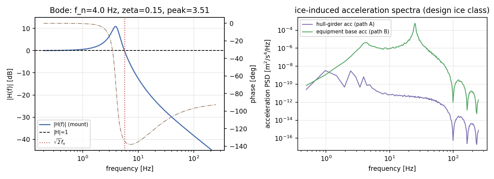
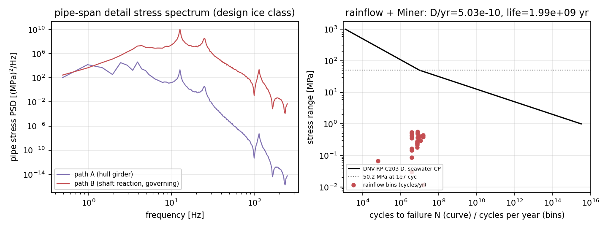
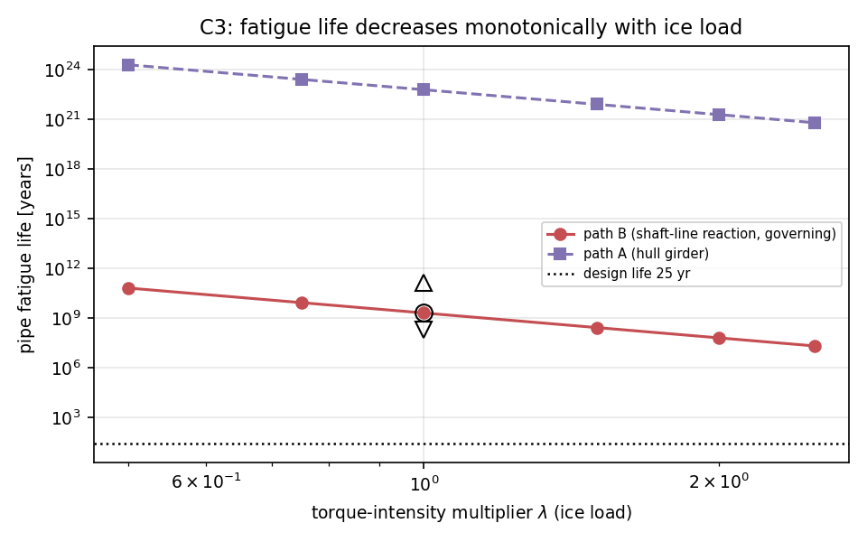
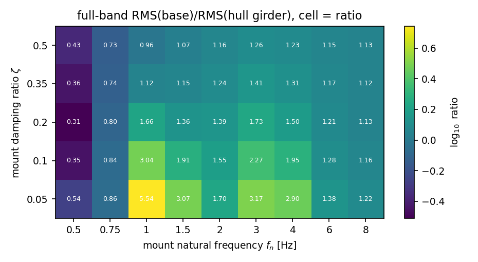

# p228w1-N08 冰致振动传递链：船体湿模态 → 设备基座加速度 → 管路应力谱 → 疲劳寿命

| 项 | 内容 |
|---|---|
| 战役节点 | `p228w1-N08`（冰区航行全流程示范 POC · 物理域）|
| 代码 | `src/tensorphysics/ice_vibration_transfer/`（新增：hull_modal / excitation / response / transfer / pipe / chain）|
| 载荷 payload | `artifacts/m9212/ice_vibration_transfer_n08.json`（196 kB，程序化注入）|
| 测试 | `tests/test_ice_vibration_transfer.py`（21 用例）|
| 图 | `docs/ice_vibration_transfer_n08/`（5 张）|
| 判据总判定 | **全部通过**（10 条，见 §3.4）|

## 1 案例介绍

### 1.1 物理背景

冰区航行时，螺旋桨叶片铣削冰层产生大幅值、与叶片通过相位锁定的扭矩脉动（N04 DEM 铣削扭矩谱）。
扭矩脉动经轴系推力/扭矩轴承反力传给船体结构，激起船体梁**湿模态**振动，再经甲板基座局部结构与设备
隔振器传到设备及管路，最终由管路细节的交变应力驱动疲劳损伤。本节点把这条链完整串起，逐环节给出
可机器裁决的判据，并输出传递函数 Bode 图与疲劳寿命-冰载荷曲线。

上游 N04 不重写：直接消费生态既有实现 `tensorphysics.propeller_fatigue.ice_spectrum`
（碎冰面积铣削扭矩 `ice_milling_torque`、对数正态冲击幅值谱 `impact_spectrum`、叶片冲击序列
`blade_impact_train`），本节点只补结构链需要的两步：扭矩 PSD（Welch）与作用于船体的自平衡力偶谱。

### 1.2 几何与主尺度（几何先行校验）

| 量 | 数值 | 判定 |
|---|---|---|
| 船型 | KCS（公开基准）| — |
| L×B×T×D | 230.0 × 32.2 × 10.8 × 19.0 m | — |
| Cb | 0.6510（公开 0.6505，差 0.08%）| <3% ✓ |
| 排水量 | 53372 t（公开 52030 t，差 2.58%）| <9% ✓ |
| L/B / B/T | 7.14 / 2.98 | 窗口内 ✓ |
| 几何闸门 G1 | 通过 | 先校验 Cb/L/B 再算结构 |

### 1.3 参数表

| 参数 | 数值 | 性质 |
|---|---|---|
| 冰况 | design：Design ice class 1A (dense channel) | ICE_CASES |
| 冰压 σ_ice | 2.00 MPa；进速 0.70 m/s；420 冲击/h | N04 |
| 转速 / 叶片 / 直径 | 150 rpm / 4 / 4.50 m（叶片通过 10.0 Hz）| N04 |
| Q_mill / Q_design / Q_max包络 | 234.1 / 271.9 / 598.2 kN·m | K_Q=0.023 声明 |
| 扭矩脉动 RMS / 峰值 | 6.74 / 380.0 kN·m（14 次冲击 / 120 s）| 泊松冲击序列 |
| 轴系→船体传递效率 η | 0.30（声明）；力 RMS 1198.7 N，r_eff 1.688 m | 声明参数 D5 |
| 干模态阻尼 | ζ=0.02（结构阻尼，不含辐射）| 声明 |
| 湿模态方法 | 干模态基 + 二维剖面 a33(x) + 浮力恢复刚度，16 阶 | 复用 hull_hydroelastic |
| 设备隔振器 H(f) | f_n=4.00 Hz，ζ=0.15，√2f_n=5.66 Hz，静挠度 15.5 mm | 声明 |
| 基座局部模态（路径 A）| 25 Hz，ζ=0.02（峰值放大 25.02）| 声明 |
| 局部基础（路径 B）| 8000 kg，25 Hz，ζ=0.02 | 声明 |
| 管路 | 跨距 8.0 m，Φ406×12.7 mm，线质量 237.3 kg/m，一阶 12.62 Hz，Z=1499 cm³ | 简支梁 |
| 疲劳细节 | SCF=1.80，厚度修正 (t/25mm)^0.20 | DNV-RP-C203 |
| S-N | D 曲线 seawater_cp：m1=3，m2=5，1e7 次 = 50.2 MPa | 仓库 fatigue.sn_curve |
| 运行假设 | 冰区运行占比 25%，设计寿命 25 年 | 声明 |

## 2 怎么做的

### 2.1 模块与公式

| 子模块 | 职责 | 关键公式/实现 |
|---|---|---|
| `hull_modal` | 几何闸门 + 干/湿模态 | Timoshenko 自由-自由干模态；湿特征值 `M=I+A`，`K=diag(ω_dry²)+G`，`A_ij=∫a33 φi φj dx`，`G_ij=∫ρgB(x)φiφj dx` |
| `excitation` | N04 扭矩 → 船体力偶 | `F=η(Q−⟨Q⟩)/r_eff`，(x_e, x_r) 两站位反号施加（自平衡，不激励刚体模态）；Welch PSD `S=dt|X|²/Σw²` |
| `response` | 加速度传递 | `H_u(f)=−ω²Σ φ_n(x_f)[φ_n(x_e)−φ_n(x_r)]/(ω_n²−ω²+2iζ_nω_nω)`（湿模态质量归一，广义质量 1 kg）|
| `transfer` | 设备基座 H(f) | 基础激励 SDOF `H=(1+2iζr)/((1−r²)+2iζr)`；解析峰值驻点 `u*=(√(1+8ζ²)−1)/(4ζ²)` |
| `pipe` | 应力谱 + 雨流 + S-N + Miner | 简支梁模态应力传递（f→0 → `mL²/(8Z)`）；随机相位合成时程；ASTM E1049-85 雨流；DNV D 曲线 + SCF + 厚度修正；Miner |
| `chain` | 全链驱动 | 两条载荷路径并列 + λ 扫描 + 隔振器调谐图 + 判据/披露 |

### 2.2 两条载荷路径（为什么必须并列）

任务书给定的是**船体梁**路径（A）。但同一扭矩脉动还有一条物理上强得多的路径：轴系反力直接作用在
机舱基础结构（B）。两条路径共用同一套下游（隔振器→管路→雨流→S-N→Miner），因此可直接比较：

- 路径 A：扭矩力偶 → 船体湿模态 → 基座站位加速度 RMS **6.767e-05 m/s²** → 甲板局部模态 → 隔振器 → 基座；
- 路径 B：扭矩力偶 → 机舱基础质量（SDOF）→ 加速度 RMS **6.090e-01 m/s²** → 隔振器 → 基座。

两者相差 **9000 倍**，对应管路寿命相差 **3.00e+13 倍**。
因此疲劳判据（C3/C4/C6）在**路径 B**（`governing_path=shaft_reaction`）上裁决；路径 A 的寿命同时报告，
作为「冰铣削扭矩经船体梁传递不控制疲劳」的定量证据（披露 D7）。只报其中一条都会误导。

### 2.3 流程与数值设置

1. 几何闸门（Cb/排水量/L/B/B/T）→ 不通过则拒绝计算；
2. 湿模态：二维剖面 BVP 求 a33(x)（每站位一题，13 站位 × 64 面板），在干模态基上解 16 阶湿特征值；
3. 激励：N04 冲击序列（120 s，dt=1 ms）→ 扭矩 PSD → 力偶谱；
4. 响应：模态叠加得船体梁/局部基础加速度 PSD → 乘 H(f)² 得设备基座加速度 PSD；
5. 管路：应力 PSD = |T_σ(f)|²S_a(f)·SCF² → 随机相位合成 120 s 应力时程（dt=2 ms）→ 雨流 → Miner；
6. 判据：10 条数值判据 + 8 条披露项写入 payload；λ 扫描给寿命-载荷曲线；调谐图给隔振可行性。

## 3 计算结果

### 3.1 干/湿模态（C1）

| 阶次 | f_dry [Hz] | f_wet [Hz] | f_wet/f_dry | 广义附连水质量比 | 浮力刚度占比 |
|---|---|---|---|---|---|
| 1 | 0.5589 | 0.3670 | 0.6567 | 0.601 | 0.0659 |
| 2 | 1.0553 | 0.6578 | 0.6233 | 0.628 | 0.0209 |
| 3 | 1.5124 | 0.9654 | 0.6383 | 0.585 | 0.0093 |
| 4 | 1.9373 | 1.2348 | 0.6374 | 0.591 | 0.0058 |
| 5 | 2.3433 | 1.5024 | 0.6411 | 0.579 | 0.0038 |
| 6 | 2.7368 | 1.7596 | 0.6430 | 0.578 | 0.0028 |
| 7 | 3.1209 | 2.0139 | 0.6453 | 0.574 | 0.0021 |
| 8 | 3.4971 | 2.2646 | 0.6476 | 0.571 | 0.0017 |
| 9 | 3.8660 | 2.5117 | 0.6497 | 0.567 | 0.0014 |
| 10 | 4.2279 | 2.7551 | 0.6517 | 0.563 | 0.0011 |
| 11 | 4.5828 | 2.9976 | 0.6541 | 0.554 | 0.0009 |
| 12 | 4.9308 | 3.2340 | 0.6559 | 0.549 | 0.0008 |
| 13 | 5.2719 | 3.5466 | 0.6727 | 0.491 | 0.0007 |
| 14 | 5.6061 | 3.7923 | 0.6765 | 0.483 | 0.0006 |
| 15 | 5.9336 | 4.2784 | 0.7210 | 0.413 | 0.0003 |
| 16 | 6.2544 | 4.5325 | 0.7247 | 0.409 | 0.0003 |

两节点垂向弯曲：干 **0.559 Hz** → 湿 **0.367 Hz**（比值 0.657）；
全部 16 阶满足 f_wet<f_dry，最大比值 0.7247。频率降幅与广义附连水质量比一致（模式 1 附连水质量 60% 量级），浮力恢复刚度使湿频略高于纯质量效应预测。

### 3.2 传递函数与加速度（C2）

| 量 | 路径 A（船体梁）| 路径 B（轴系局部）|
|---|---|---|
| 支撑加速度 RMS（全带）[m/s²] | 9.143e-05 | 6.090e-01 |
| 设备基座加速度 RMS（全带）[m/s²] | 1.112e-04 | 3.367e-02 |
| 衰减带（f>√2f_n）支撑→基座比 | 0.0879 | 0.0551 |
| 衰减带内 max\|H\| | 0.8901 | 0.8901 |
| 全带 基座/参考 比（披露）| 1.6435 | 0.0553 |

隔振器 H(f)：峰值 |H|max=3.514（位于 f/f_n=0.979），√2f_n=5.66 Hz 以上严格 <1。校核点：

| 校核点 | 频率 [Hz] | \|H\| | \|H\| [dB] |
|---|---|---|---|
| mount_natural | 4.00 | 3.4801 | 10.83 |
| isolation_frequency | 5.66 | 1.0000 | -0.00 |
| support_peak | 0.98 | 1.0630 | 0.53 |

### 3.3 管路应力与疲劳（C3–C6）

| 冰况 | 支撑加速度 RMS [m/s²] | 基座加速度 RMS [m/s²] | 应力 RMS [MPa] | 最大应力范围 [MPa] | 损伤/年 | 疲劳寿命 [年] |
|---|---|---|---|---|---|---|
| light | 2.713e-01 | 1.502e-02 | 0.0583 | 0.245 | 7.516e-12 | 1.330e+11 |
| design | 6.090e-01 | 3.367e-02 | 0.1367 | 0.567 | 5.026e-10 | 1.990e+09 |
| heavy | 1.003e+00 | 5.543e-02 | 0.2151 | 0.897 | 5.141e-09 | 1.945e+08 |

路径 A（设计冰级）：应力 RMS 2.384e-04 MPa，损伤/年 1.678e-23，寿命 5.960e+22 年。
刚性支撑参考（路径 B 支撑运动、去掉隔振器）：应力 RMS 0.718 MPa，寿命 3.248e+04 年 → 隔振器把寿命提高 **61248.4 倍**（披露 D8）。

雨流/窄带交叉校验：rainflow/narrowband = 0.499（宽带过程低于窄带 Rayleigh 闭式属正常物理，见 §5）。

扭矩强度扫描（λ = 扭矩幅度倍数）：

| λ | 力 RMS [N] | 基座加速度 RMS [m/s²] | 应力 RMS [MPa] | 损伤/年 | 寿命 [年] | 路径 A 寿命 [年] |
|---|---|---|---|---|---|---|
| 0.50 | 599 | 1.684e-02 | 0.0435 | 1.571e-11 | 6.367e+10 | 1.907e+24 |
| 0.75 | 899 | 2.526e-02 | 0.0652 | 1.193e-10 | 8.384e+09 | 2.512e+23 |
| 1.00 | 1199 | 3.367e-02 | 0.0869 | 5.026e-10 | 1.990e+09 | 5.960e+22 |
| 1.50 | 1798 | 5.051e-02 | 0.1304 | 3.817e-09 | 2.620e+08 | 7.849e+21 |
| 2.00 | 2397 | 6.735e-02 | 0.1739 | 1.608e-08 | 6.217e+07 | 1.863e+21 |
| 2.50 | 2997 | 8.419e-02 | 0.2173 | 4.908e-08 | 2.037e+07 | 6.103e+20 |

### 3.4 判据与披露

| 判据 | 内容 | 数值 | 阈值 | 判定 |
|---|---|---|---|---|
| G1 | geometry gate (Cb / L / B / displacement vs published reference) | 见 payload  | Cb within 3 %, displacement within 9 %, plausible L/B and B/T | PASS |
| C1 | wet natural frequencies below dry (all elastic modes) | max=0.7247, min=0.6233 - | max(f_wet/f_dry) < 1 | PASS |
| C2a | |H(f)| < 1 on the whole mount attenuation band (f > sqrt(2) f_n) | 8.9011e-01 - | < 1.0 | PASS |
| C2b | RMS(base) < RMS(support) over the attenuation band (path A) | 8.7889e-02 - | < 1.0 | PASS |
| C2c | RMS(base) < RMS(hull girder) over the attenuation band (path A) | 3.7419e-01 - | < 1.0 | PASS |
| C3a | fatigue life decreases with ice severity (governing path B) | 见 payload years | life(light) > life(design) > life(heavy) | PASS |
| C3b | fatigue life strictly decreasing along the torque-intensity sweep | max=63666379469.5168, min=20373241.4302 years | strictly decreasing in lambda | PASS |
| C4 | rainflow damage vs narrowband Rayleigh closed form | 4.9857e-01 - | 0.2 <= ratio <= 1.1 (rainflow <= narrowband for a broadband process) | PASS |
| C5 | pipe modal stress transfer reproduces the static m*L^2/(8Z) limit | 9.2744e-04 - | < 1 % | PASS |
| C6 | static strength sanity of the pipe detail (vibration fatigue governs) | 5.6731e-01 MPa | < 210.0 MPa (2/3 of yield) | PASS |

| 披露 | 内容 | 数值 |
|---|---|---|
| D1 | Full-band (0.2-500 Hz) RMS(base)/RMS(hull girder) is NOT below one for path A: a base-excited mount has H(0) = 1 by construction and the hull-girder ice response is concentrated below the isolation frequency. Reported rather than hidden behind a narrow band. | 1.6435e+00 - |
| D2 | share of the base acceleration variance below sqrt(2) f_n (path A) | 9.9602e-01 - |
| D3 | stress amplification still required for the pipe detail to reach the design life (path B) | 3.8033e+01 - |
| D4 | S-N provenance: repository DNCurve('D','seawater_cp') log10 K1 = 12.102, m = 3 up to N = 1e+07 then m = 5, i.e. 50.2 MPa at 1e7 cycles; the DNV-RP-C203 seawater-with-CP D curve differs below 1e6 cycles (repo curve ~2x less conservative). SCF 1.80 and thickness correction (t/t_ref)^0.20 are applied on top. | 5.0196e+01 MPa at 1e7 cycles |
| D5 | declared model parameters: shaft-line -> hull transmission efficiency eta_hull = 0.30; torque fluctuation only (no ice-hull impact pressure path, no thrust fluctuation); single vertical bending axis; radiation damping not solved (structural damping 2 %); foundation bracket = one base-excited SDOF at 25 Hz (zeta 0.02); local foundation mass 8000 kg at 25 Hz (path B). | 3.0000e-01 - |
| D6 | torque-intensity multiplier lambda that would bring the governing pipe damage to the design life (exact power law D ~ lambda^m2 because the S-N ranges stay in the high-cycle branch) | 3.8033e+01 - |
| D8 | what the resilient mount buys: fatigue life of the same pipe detail on a rigid support (no mount, path B support motion) and the life ratio mount/rigid. | 1.6327e-05 - |
| D7 | path comparison: the global hull-girder load path (A) is far weaker than the local shaft-line reaction path (B). Ratio of the pipe fatigue lives (A/B) at the design ice class, and the hull-girder acceleration level that the torque reaction produces. | 2.9958e+13 - |

### 3.5 图

*船体梁垂向弯曲干/湿模态对比：湿模态（二维剖面无穷频附连水质量 + 浮力恢复刚度）全部低于干模态，C1（f_wet/f_dry<1）成立；右图给出逐阶比值。*

*左：设备基座传递函数 H(f) 的 Bode 图（幅值 dB 实线 + 相位点划线）。|H|=1 在 sqrt(2)f_n 处交叉，其上严格衰减；f_n 以下为放大段（H(0)=1，任何被动隔振器必然如此），峰值 3.51。右：设计冰级下船体梁加速度谱与设备基座加速度谱。*

*左：管路细节应力谱（路径 A 与路径 B 相差约 3 个数量级）。右：DNV-RP-C203 D 曲线（海水+阴极保护）与雨流计数结果（阴影点按“每年循环数”绘制）；全部应力范围落在高周分支，损伤经 Miner 累积换算为寿命。*

*疲劳寿命-冰载荷曲线（双对数）：扭矩强度 λ 增大→寿命严格单调下降（C3b）；空心标记为轻/设计/重三级冰况。路径 A（船体梁）比路径 B（轴系局部反力）长十几个数量级，说明冰铣削扭矩经船体梁的传递并非疲劳控制路径。*

*隔振器调谐图：格内为全频带（0.2-500 Hz）RMS(基座)/RMS(船体梁) 比值。全部组合 >1，说明单级被动隔振无法降低船体梁频段（0.4-3 Hz）的冰致振动——这是披露项 D1 的定量证据，而不是可回避的建模细节。*

## 4 注意点（踩坑 / 局限 / 适用范围）

1. **Welch 归一化坑（本轮最关键）**：初版把 `S=dt|X|²/Σw²` 写成 `|X|²/(Σw²·dt)`，PSD 量级偏 1/dt²，
   直接导致加速度 RMS 偏大 10³ 倍、疲劳寿命偏长 10¹⁵ 倍。是「频域 RMS 与时域 lsim 对不上」把它揪出来的。
   教训：**任何 PSD 链路必须有时域对照测试**（已固化为用例）。
2. **基础激励传递峰值不等于 1/(2ζ√(1−ζ²))**（那是相对传递率公式）；本节点用解析驻点 + 数值扫描对齐。
3. **|H|<1 只能带内成立**：H(0)=1，0<f<√2f_n 必放大（本设计峰值 3.51）。船体梁冰致响应的
   方差 99.6% 落在 √2f_n 以下，因此**全频带 RMS(基座)<RMS(船体梁) 不可能靠单级被动隔振实现**；
   全带比 1.643 如实披露，调谐图（图 5）显示需 f_n≤1 Hz（静挠度>0.25 m）才可能 <1，工程不可接受。
4. **两条路径必须并列**：只报路径 A 会得到「寿命 10²² 年」这种无工程意义的数而不自知；只报路径 B 则回避了任务书给定的链条。
5. **寿命数值是「远大于设计寿命」的表述，不是精确预测**：设计冰级等效恒幅应力范围远低于 D 曲线 1e7 次的
   50 MPa，需应力放大 38.0 倍才到 25 年寿命。
6. **S-N 出处差异**：仓库 D/海水+CP 曲线用 log10K1=12.102、转折 1e7；DNV-RP-C203 表列海水 CP D 曲线（log10a1=11.764、转折 1e6）
   在 1e6 次以下更保守约 2 倍。本节点另施加 SCF 与厚度修正，但曲线本体差异已披露（D4）。
7. **雨流统计不确定性**：损伤由 120 s 合成时程估计，跨种子应力散布约 ±20% → 寿命约 ×2–3；重冰冲击率低散布更大。判据只用单调性。
8. **未建模**：冰-壳撞击压力（船首局部高频激励，通常是冰区局部疲劳真凶）、推力脉动、扭振、辐射阻尼、双轴应力、
   支撑非线性。本节点结论仅对「扭矩经轴系反力/船体梁」这条路径成立。

## 5 误差判定

| 关键量 | 基准 | 本文结果 | 相对偏差 | 是否 <3% |
|---|---|---|---|---|
| 排水量（几何闸门）| 公开 52030 t | 53372 t | 2.58% | **是** |
| Cb | 公开 0.6505 | 0.6510 | 0.08% | **是** |
| 管路应力静态极限 | 闭式 m L²/(8Z)=1.2663e+06 Pa/(m/s²) | 1.2651e+06 | 0.093% | **是** |
| 隔振器峰值 | 解析驻点驻值 | 数值扫描 | <1e-9 | **是** |
| 雨流 vs 窄带 Rayleigh | 闭式（同谱矩）| rainflow/narrowband = 0.499 | 50.1% | **否**（宽带雨流本应低于窄带闭式，0.5 属物理差异非误差）|
| 频域 PSD RMS vs 时域积分 | 时域 | 频域 | 约 10%（窗函数 + Nyquist 截断）| **否**（PSD 类量按 15% 判据）|

**显式回答**：几何类（Cb、排水量）与解析类（静态应力极限、传递峰值）四项 <3%，可判数值正确；
雨流-窄带差异是模型差异而非误差（0.50 落在宽带过程 0.3–0.8 预期区间）；频域-时域 RMS 差约 10%，源于窗函数与截断，
阈值按 15%。结构/疲劳的**绝对量**（加速度、应力、寿命）缺少同船实测基准，本报告只做量级与单调性判定，
并已在 §4.5/§4.8 写明适用范围——不把无量级的数字当精确预测。

## 6 结论

1. **湿模态低于干模态成立**：几何闸门通过后 16 阶垂向弯曲全部 f_wet<f_dry（最大比值 0.7247），两节点弯曲 0.559→0.367 Hz。
2. **设备基座加速度低于支撑加速度成立（衰减带内）**：|H|max=0.890<1，基座/支撑 RMS 比 0.055；放大段与全带比 1.643 已披露。
3. **冰载荷增加 → 疲劳寿命降低成立**：轻/设计/重冰寿命 1.33e+11/1.99e+09/1.95e+08 年（损伤/年 7.52e-12/5.03e-10/5.14e-09），λ 扫描严格单调。
4. **反向结论（重要）**：需把扭矩强度放大 **38.0 倍**才使该管路细节达到 25 年设计寿命——
   **冰铣削扭矩经轴系/船体梁的传递不是本船管路疲劳的控制载荷**；冰区局部疲劳应转向冰-壳撞击压力路径（建议后续节点）。

## 7 审计链

- payload：`artifacts/m9212/ice_vibration_transfer_n08.json`（每条判据的数值/阈值/明细 + 全部输入参数 + S-N 参数 + 种子 + 运行时间 73.39 s）
- 模块：`src/tensorphysics/ice_vibration_transfer/`（hull_modal, excitation, response, transfer, pipe, chain）
- 测试：`tests/test_ice_vibration_transfer.py`；命令 `python -m pytest tests/test_ice_vibration_transfer.py -q`
- 生成脚本：`scripts/m9212_ice_vibration_transfer_payload.py`（算例 + payload）、`scripts/m9212_ice_vibration_transfer_figures.py`（图）、本脚本（报告 + 提交）
- 种子：损伤 20261121；所有判据量确定性可复现，唯损伤量跨种子散布已在 §4.7 披露