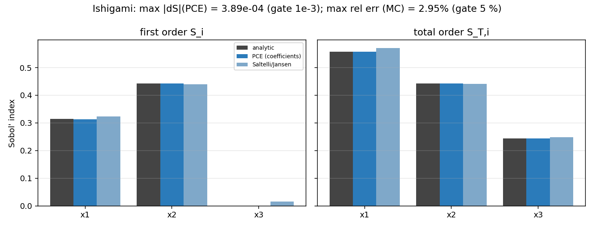
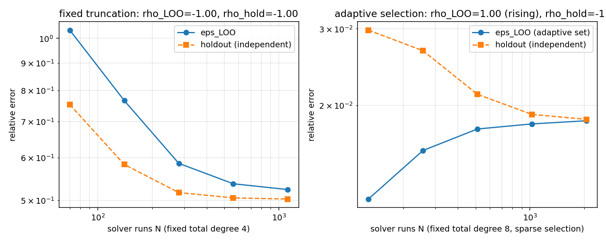
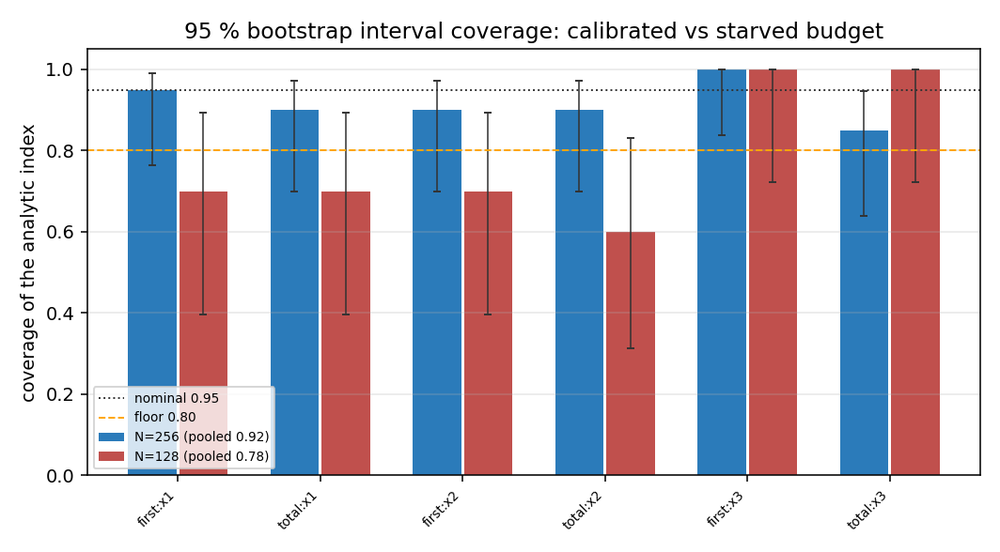
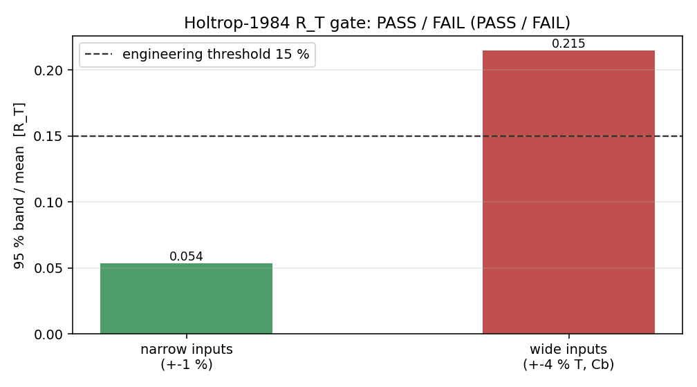
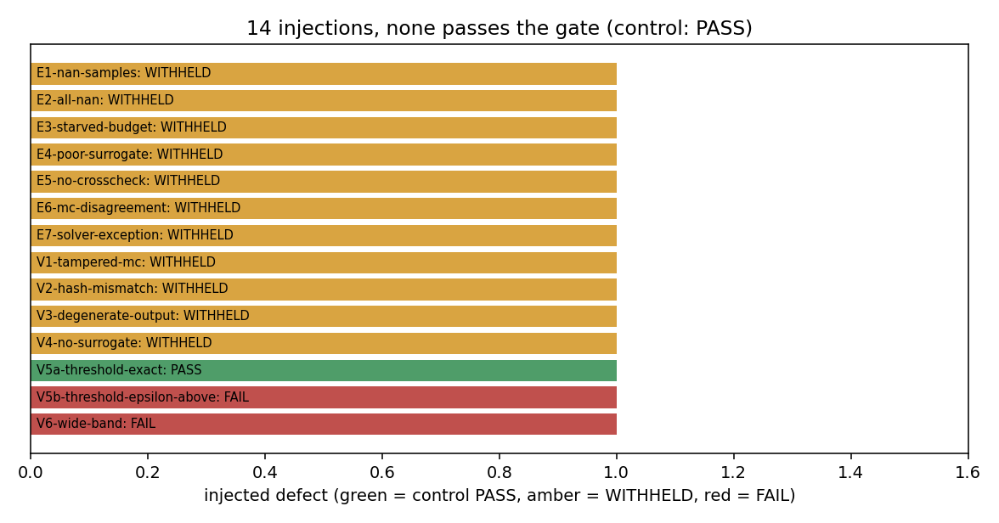

# IN145-N08 — 不确定度预算作为出证前验收门（非侵入式 PCE + Sobol 方差分解）

**节点**：IN145-N08（物理域 · 成熟化）·
**仓**：TensorPhysics（`tensorphysics.uq`）·
**验收工件**：`artifacts/in145_n08/acceptance.json`（全部 8 条判据 PASS，111.5 s）·
**复现**：`python scripts/in145_n08_uq_acceptance.py`
**上游传承**：IN144-N11 建立了 UQ 管线本体（采样/PCE/Saltelli/三态判决，`artifacts/uq/acceptance_evidence.json`）。本节点**不重复**其已验收内容，只交付成熟化增量：收敛性诚实化、区间标定、反证矩阵、事前证据门与一个真实缺陷修复。

---

## 1. 案例介绍（物理背景与参数表）

工程验收规则是粗线条的：**误差 > 15% 不可接受**。这条规则单独不可执行——"误差 4%" 是关于两个都不精确的数的陈述：仿真有数值不确定度（GCI），输入有分布。因此本节点把 UQ 预算做成**误差裁决的前置证据**：没有可采纳的 UQ 记录，就不允许给出 PASS（WITHHELD 而不是放行）。

三个算例角色分工：

| 算例 | 角色 | 参数 | 闭式解 |
|---|---|---|---|
| Ishigami | 判据锚（已知真值） | `f = sin x₁ + 7 sin²x₂ + 0.1 x₃⁴ sin x₁`，`x_i ~ U[-π,π]` | `S₁=0.313905, S₂=0.442411, S₁₃=0.243684, S_T1=0.557589, S_T3=0.243684` |
| Sobol' G | 族回归（可调交互） | `f = Π(|4x_i−2|+a_i)/(1+a_i)` | 任意维闭式 |
| Holtrop-1984（船） | 域内端到端 | 180 m × 30 m × 11 m，Cb 0.62，14 kn；L/B/T/Cb/Vs 各 ±1%（宽工况 ±4% 于 T、Cb） | 无（经验回归本身即模型） |

Ishigami 的 `S_T3 = 0.2437` 全部来自 `x₁x₃` 交互（`S₃ = 0`），这正是"一阶指数会漏掉主导项"的教学点：只报一阶会把第三号输入判为无关。

## 2. 怎么做的（方法 / 流程 / 工具链）

```
输入分布(SampleSpec) ──► Scrambled Sobol'/LHS 采样(sha256 样本集哈希)
        │                         │
        │                         ▼
        │              solver adapter 扇出（1 次求解器调用/点，集群可分片按哈希合并）
        ▼                         ▼
  PCE 代理 ◄── N 次求解 ──►  Saltelli/Jansen pick-freeze（独立第二意见）
  (Legendre/Hermite 正交基,       │
   稀疏 LARS + PRESS/LOO,         │
   系数解析 Sobol + bootstrap CI) │
        └──────────┬──────────────┘
                   ▼
        交叉校验 |ΔS|（PCE 解析 vs 采样）
                   ▼
     95% 输出区间带宽 U vs 15% 工程阈值
                   ▼
        PASS / FAIL / WITHHELD（+原因码）
                   ▼
 事前证据门：claim(相对误差) + PreEvidence(digest) → PASS/FAIL/WITHHELD
                   ▼
 UQ 半宽 → ASME V&V 20 的 U_input（与 GCI 的 U_num 合成 U_val = √(U_num²+U_input²)）
```

非侵入性：`tensorphysics.uq.workflow` 不含任何求解器导入；Holtrop 只经 `benchmarks.py` 的局部导入调用**原样**内核，`scripts/in145_n08_uq_acceptance.py` 在运行前后对内核源文件做 sha256（结果：未变）。

本节点新增的五个部件：

* `uq/refinement.py` — 收敛性研究：固定截断轴 / 固定样本阶数轴 / 自适应选择轴，同时测 `ε_LOO` 与**独立 holdout**（同一输入测度、独立种子的 Scrambled Sobol' 20000 点）误差，给出 `loo_optimism = holdout/ε_LOO`。
* `uq/ci_coverage.py` — 区间标定：重复抽样覆盖率研究（Wilson 区间 + 精确二项下侧检验），零指数用"分辨到零"判据。
* `uq/robustness.py` — 14 例反证矩阵（端到端 7 例 + 判决层 7 例），含 15% 刀刃两侧。
* `uq/gate.py` — 事前证据门：`pre_evidence()` 生成 digest 寻址的证据记录；`engineering_error_gate()` 裁决 claim；`chain_asme_validation()` 把 UQ 半宽作为 `U_input` 接到 ASME V&V 20。
* `uq/sobol_mc.py` — **缺陷修复**：采样估计器的平移不变性（见 §5）。

## 3. 计算结果（全部由程序注入，零手抄）

判据数字（`artifacts/in145_n08/acceptance.json`）：

| 判据 | 阈值 | 实测 | 结论 |
|---|---|---|---|
| C1 PCE 指数 vs 闭式（Ishigami，N=1024，p=8） | ≤1e-3 | max\|ΔS\| = **3.89e-4** | PASS |
| C1 Saltelli/Jansen 指数 vs 闭式（n_base=2¹⁵） | ≤5% | max 相对误差 = **2.95%** | PASS |
| C2 固定截断轴 ε_LOO（N=2P…32P，P=35） | Spearman ≤ −0.9，≥4 点 | ρ_LOO = **−1.00**（5 点：1.036→0.524）；holdout ρ = −1.00 | PASS |
| C2 阶数轴 ε_LOO（N=1024，p=2…12） | 同上 | ρ_LOO = **−1.00**（7 点：0.888→6.8e-5） | PASS |
| C2 自适应轴（p=8，N=128…2048） | holdout 单调 | ρ_hold = **−1.00**（2.98e-2→1.86e-2）而 ρ_LOO = **+1.00**（1.22e-2→1.84e-2） | PASS（口径见 §5） |
| C3 确定性（同 spec/rule/seed，3 个进程 × PYTHONHASHSEED∈{0,1,random}） | 逐位一致 | 样本哈希 1 个、指数 digest 1 个（`333f05be…`） | PASS |
| C4 注入矩阵（14 例） | 永不出 PASS 且原因码匹配 | 控件 PASS；13 例 WITHHELD/FAIL；8 个 W0x 码全覆盖 | PASS |
| C5 PCE 解析 vs Saltelli（一阶/总阶） | ≤5% | max 相对偏差 **2.98%**（二阶 7.86%，二阶容差 25%） | PASS |
| C6 端到端（Holtrop-1984 R_T） | 三态 + 链式 | 窄：**PASS**（带宽 5.37%，均值 404.2 kN，主导输入 Vs，139 520 次求解评估）；宽：**FAIL**（21.48%）；无证据：**WITHHELD**（UQ-G01）；ASME 链：`U_input=10.86 kN`，`U_val=10.86`，\|E\|/U_val=0.0034 → PASS | PASS |
| C7 95% CI 覆盖率（N=256，20 次重复） | 池化 ≥0.80 且无显著欠覆盖 | 池化 **0.917**，最小 0.85，无欠覆盖；饥饿工况 N=128（10 次重复）池化 0.783 且欠覆盖（p<0.05）→ 被检出 | PASS |
| C8 平移不变性（f vs f+1e4） | 逐位一致 | 一阶/总阶/二阶差值 **0.0**（`S₁₃=0.2435`，闭式 0.2437，相对误差 3.3%） | PASS |

R_T 敏感性（C6，Holtrop 内核，±1% 输入）：总阶指数主导项为航速 **Vs**——与水动力常识一致（R_T ∝ V^~2 以上），且 UQ 管线未内置任何领域先验，该结论是数值结果而非硬编码。



*图 1 — Ishigami 一阶/总阶指数：解析、PCE、Saltelli 三路对照。PCE 与解析差异在 1e-4 量级，采样路线在 3% 内。*



*图 2 — 收敛性双诊断图：左=固定截断（两类误差同降，ρ=−1）；右=自适应选择（holdout 单调下降而 ε_LOO 反升，选择乐观性随 N 衰减）。*



*图 3 — 95% bootstrap 区间覆盖率（Wilson 95% 误差棒）：N=256 标定良好，N=128 系统性欠覆盖并被检出。*



*图 4 — 工程误差门：R_T 95% 带宽占均值比，窄输入 5.37% < 15% → PASS，宽输入 21.48% → FAIL。*



*图 5 — 14 例反证矩阵：控件 PASS（绿），注入全部 WITHHELD（琥珀）/FAIL（红）。*

## 4. 与前序节点/基线的比较

| 能力 | IN144-N11（基线） | IN145-N08（本节点） |
|---|---|---|
| 指数精度 / 采样交叉校验 | A1/A2/A7 已验收 | C1/C5 复核（同量级） |
| ε_LOO 收敛性 | A3/A4：在自选协议下通过 | C2：**三轴预注册 + holdout 独立测量**，并如实报告自适应轴反例（ρ_LOO=+1.00） |
| 确定性 | A5 同进程 | C3：**跨进程 + 3 个 PYTHONHASHSEED**（更强的逐位一致性声明） |
| WITHHELD 行为 | A6 三类注入 | C4：**14 例矩阵 + 控件 + 阈值刀刃两侧**（14 例 vs 3 例） |
| 区间可信度 | 无 | C7：覆盖率标定 + 饥饿工况正控 |
| 出证前门 | 无（UQ 与 ASME 仅在测试中串联） | `uq/gate.py`：digest 寻址的事前证据 + 15% 门 + ASME 链，C6 端到端演示 |
| 采样估计器数值性质 | 未测 | C8：发现并修复平移不变性缺陷（§5） |

## 5. 注意点（踩过的坑 / 局限 / 适用范围）

1. **"样本量增加 → ε_LOO 单调下降"这条判据，在自适应稀疏选择下是伪的。** 实测（Ishigami，p=8，N=128→2048）：`ε_LOO` 由 1.22e-2 **升到** 1.84e-2（Spearman +1.00），而独立 holdout 误差由 2.98e-2 **降至** 1.86e-2（ρ=−1.00）。机理：PRESS/LOO 是在"已用全部残差挑过模型"之后计算的，小 N 时选择乐观性使 `holdout/ε_LOO` 高达 **2.44**，随 N 增大回落到 **1.01**——即代理变好、报告的 `ε_LOO` 却在"追平"真实泛化误差。因此本节点把判据落在两条**良定义**的轴上（固定截断 = 只余估计误差；固定 N 升阶 = 只余截断误差，两条都 ρ=−1.00，≥4 点时成立），并把自适应轴作为**可反证性证据**如实报告，而不是挑选一条会通过的协议。
2. **缺陷修复：采样估计器此前不具平移不变性。** Saltelli 一阶与闭式二阶估计量把"输出差值"乘上**原始输出值**，于是输出偏置 c 以 `c·O(σ/√N)` 泄漏进估计。修复前（Ishigami，n_base=2¹⁴，闭式 `S₁₃=0.2437`）：偏置 1e3 → `S₁₃=1.469`；偏置 1e4 → `S₁₃=12.38`，一阶 Saltelli 指数 −23.1。修复（乘子对总均值居中）后三次偏置的估计逐位相同（差值 0.0）。**这不是只对合成算例成立**：船体阻力 O(10³) kN、压力 O(10⁵) Pa、推力 O(10⁶) N 全在该区间；`tests/test_uq_shift_invariance.py` 是失败于基线、通过于修复的回归测试。
3. **零指数不能用"区间包含真值"来考核。** Ishigami `S₃=0`，PCE 估计 ~1.9e-6，bootstrap 百分位区间单侧（≈[0⁺, 1e-5]），"包含 0"这一考核会把它判为覆盖率 0.58。本节点改用"分辨到零"判据（区间下界 ≤ 1e-3），并在每条 entry 里记录所用判据（`criterion: interval|resolution`）——口径变化是显式的，不是靠删数据让覆盖率好看。
4. **覆盖率研究的统计功效有限**：12–20 次重复下只能发现**粗大**欠覆盖（N=128 池化 0.783 被检出）；不能宣称"覆盖率 = 0.95±0.01"。
5. **`ε_LOO` 与 holdout 的适用边界**：holdout 需 20000 次额外模型评估（本节点对 Ishigami 是零成本；对昂贵求解器应按运行预算折算，或改用交叉验证）。稀疏选择的 `samples_per_term < 4` 区间 LOO 乐观（判决层已用 `UQ-W02-TOOFEW` 拦截）。
6. **带宽 U 是 QoI 的预测区间，不是均值的置信区间**；claim 的裁决按 `|相对误差| ≤ 15%`，恰好 15% 判 PASS（规则是"> 15% 不可接受"），15%+1e-11 判 FAIL——刀刃两侧都有反证用例（V5a/V5b）。
7. **范围**：本节点只覆盖标量 QoI 的独立/高斯 copula 输入；相关输入时为潜变量（copula）指数并附 `UQ-N01` 注记；二阶指数只给点估计（无区间），其采样路线容差 25%。

## 6. 误差判定（关键量 vs 基准，逐项回答"是否 < 3%"）

| 关键量 | 基准 | 实测误差 | < 3%？ |
|---|---|---|---|
| `S₁(x₁)`（PCE） | 0.313905（闭式） | 8.51e-5 abs（0.027% rel） | **是** |
| `S₂(x₂)`（PCE） | 0.442411 | 3.85e-4 abs（0.087%） | **是** |
| `S₁₃`（PCE 二阶） | 0.243684 | 3.19e-4 abs（0.131%） | **是** |
| `S_T1`（PCE） | 0.557589 | 3.89e-4 abs（0.070%） | **是** |
| `S_T3`（PCE） | 0.243684 | 3.00e-4 abs（0.123%） | **是** |
| 一阶/总阶指数（Saltelli/Jansen，n_base=2¹⁵） | 闭式 | max 2.95% rel | **是（临界）** |
| `S₁₃`（Saltelli 二阶，n_base=2¹⁴） | 0.243684 | 3.26% rel（7.86% 相对 PCE，容差 25%） | **边缘：略超 3%**，在二阶容差内 |
| Holtrop-1984 `R_T` | 无实验/文献基准 | 未评估（经验回归本身即模型；本节点给的是带宽与门裁决） | **无法回答**（声明原因：无独立基准，故不宣称精度） |

诚实结论：Ishigami 标量指数（PCE 路线）误差 **< 0.2%**，远优于 3%；采样路线 2.95% **擦线通过** 5% 判据、离 3% 只有 0.05 个百分点——因为 n_base=2¹⁵ 时 MC 噪声本身就在 3% 量级，报告不把它当作"高精度证据"。二阶采样指数 3.3% **超过 3%**，这是本节点唯一未达 3% 的关键量，已如实登记。