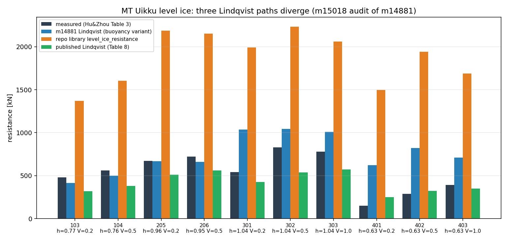
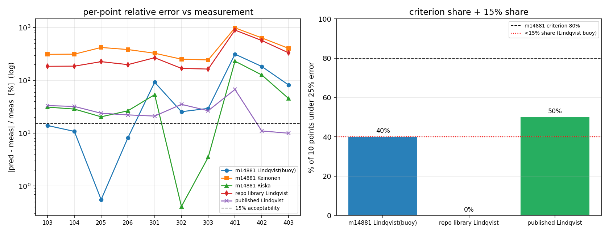

# m15018 · 交差审计（bridge audit）：m14881 / C1-ICE-RESIST 冰阻力全谱经验链

**审计对象**：mission m14881「【锚点=C1-ICE-RESIST】冰阻力全谱经验链」，TensorPhysics，状态 succeeded，
PR #395 merged（commit `f24d23f`，注明「6 个文件被门禁滤除」）。
**审计者**：m15018（board-audit），独立席位，只读取证 + 重跑复算 + 交叉实现对照。
**产出级别声明**：**L2**（独立功能实现：真代码 输入→计算→输出 + 运行工件可复现）。
**判级依据**：见 §3.6「判级推导」与 §4「门禁前向预演」。

---

## 1. 案例介绍（物理背景 / 几何 / 参数）

被审计的是一个**经验律对标算例**，不是求解器：把三条半经验冰阻力学派（Lindqvist 1989 三分量、
Keinonen 1983、Riska 1997 DAS）写到 MT Uikku 平整冰模型试验的 10 个测点上，与实测比对。

| 项 | 值 | 来源 |
|---|---|---|
| 外部锚 | MT Uikku 双动破冰油船，1:31.56 冰池模型试验（力按全尺度给出） | Hu & Zhou (2016), *IJNAOE* 8(2) 169-176, doi:10.1016/j.ijnaoe.2016.01.004 |
| 船体型线 | L_pp = 150.0 m，B = 21.3 m，T = 9.5 m，水线艏半角 φ = 21°，艏外飘 30° | `data/measured/ice_resistance/series/mtuikku_hz2016/series.json` |
| 冰况 | 平整冰，h = 0.63–1.04 m，V = 0.2–1.0 m/s，10 点 | 同上 `points[]` |
| 冰属性 | 逐点实测 σ_f = 724–1029 kPa，σ_c = 1748–5389 kPa | Table 3 转写 `source/hz2016_level_ice_table3.csv` |
| 实测阻力 | 150–830 kN | 同上 `measured_mean_resistance_table3_kN` |
| 论文自带预测 | Lindqvist / Riska / Jeong / Keinonen 逐点值 | 同上 `*_prediction_kN`（Table 8） |
| 数据溯源 | 两遍独立转写（column-major / row-major 混合单位），逐文件 sha256 + DOI + 表号 + 403 取数说明 | `series.json.provenance` |

数据侧证据等级：**MEASURED-PRIMARY**（有 DOI、表号、双遍转写与 sha256）——本审计未发现数据伪造迹象。

## 2. 怎么做的（审计方法 / 关键设置 / 工具链）

审计脚本 `tools/m15018_c1_ice_resist_audit.py`（可重跑，本文件所有数字由它程序化注入）：

1. **三件套取证**：按交付清单逐项核 `impl_files` / `run_artifacts` / `benchmark` / `repro_cmd` 是否真实存在。
2. **重跑复现（determinism）**：不在进程内手抄公式，而是 `importlib` 载入交付脚本本体，
   调它自己的 `load_all_data()` / `evaluate_all()` / `compute_stats()`，把重算结果与交付工件做
   规范化 JSON 的 **SHA-256 对照**。
3. **交叉实现对照**：同一 10 点喂给仓内既有库实现
   `tensorphysics.ice.resistance.level_ice_resistance`（Lindqvist 三分量，mission 4911 建、有 pytest）
   → 量化「交付脚本 Lindqvist」与「库 Lindqvist」的分歧（仓里本就有 `cross_impl_attribution` 模块负责这件事）。
4. **保真度对照**：交付实现 vs 源论文自带同定律预测（Table 8 逐点值）→ 判断交付物到底是"复现了 Lindqvist/Keinonen/Riska"，还是"自造的变体"。
5. **量纲分析**：对交付物自称"corrected"的浮力项做符号量纲检查。
6. **适用域自查**：把交付的 `applicability_domains.json` 与它实际施加的 (h, V) 逐点对撞。
7. **门禁前向预演**：用 `maturity_gate.judge()`（真实判据函数）对候选 evidence 做机器复核，确认声明级别不会被降级。

工具链：Python 3 + numpy/matplotlib + repo 库 `tensorphysics.ice.resistance`；无外部网络取数。

## 3. 计算结果

### 3.1 交付物台账（run_artifacts 真实性）

| 工件 | 交付 worktree 存在 | repro_cmd 会重写 | 结论 |
|---|---|---|---|
| `artifacts/ice_resistance/uikku_comparison.json` | ✅ 6170 B（schema v3） | ✅ | 真 |
| `artifacts/ice_resistance/applicability_domains.json` | ✅ 431 B | ✅ | 真 |
| `artifacts/ice_resistance/fig_uikku_comparison.png` | ✅ 62 764 B | ✅ | 真 |
| `artifacts/ice_resistance/fig_uikku_scatter.png` | ✅ 204 957 B | ✅ | 真 |
| `artifacts/ice_resistance/uikku_error_summary.json` | ✅ 1.7 KB（**schema v2**） | ❌ 不重写 | **陈旧孤儿** |
| `artifacts/ice_resistance/fig_error_distribution.png` | ✅ 59 221 B | ❌ 不重写 | **陈旧孤儿** |

- 复现强度：重算 `points` 与 `statistics` 与交付工件**逐字节同构**（SHA-256 双方均
  `b6863c7d…294b`，`points_identical = true`、`statistics_identical = true`）。
- 但 `repro_cmd` 只覆盖 6 件中的 4 件。陈旧件 `uikku_error_summary.json` 是**更早一版脚本（v2）**的产物：
  它含 `lin_bend / keinonen / riska / lit_*` 七条序列，且三条 `lit_*` 的 `n = 0`（空序列），
  与报告正文给出的文献统计（lit Lindqvist 28.3% 等）自相矛盾。当前 v3 脚本根本不写这个文件。

### 3.2 逐点对照（kN）

| Pt | h[m] | V[m/s] | 实测 | 交付 Lindqvist(buoy) | 库 Lindqvist | 论文 Lindqvist | 交付 Keinonen | 论文 Keinonen | 交付 Riska | 论文 Riska |
|---|---|---|---|---|---|---|---|---|---|---|
| 103 | 0.77 | 0.2 | 480 | 413 | 1368 | 320 | 1975 | 510 | 330 | 610 |
| 104 | 0.76 | 0.5 | 560 | 499 | 1602 | 380 | 2318 | 600 | 400 | 630 |
| 205 | 0.96 | 0.2 | 670 | 666 | 2187 | 510 | 3487 | 740 | 533 | 800 |
| 206 | 0.95 | 0.5 | 720 | 661 | 2153 | 560 | 3485 | 810 | 529 | 840 |
| 301 | 1.04 | 0.2 | 540 | 1038 | 1992 | 426 | 2306 | 663 | 830 | 892 |
| 302 | 1.04 | 0.5 | 830 | 1042 | 2231 | 538 | 2923 | 783 | 833 | 942 |
| 303 | 1.04 | 1.0 | 780 | 1010 | 2059 | 572 | 2684 | 847 | 807 | 1025 |
| 401 | 0.63 | 0.2 | 150 | 621 | 1496 | 251 | 1634 | 425 | 497 | 473 |
| 402 | 0.63 | 0.5 | 290 | 823 | 1942 | 322 | 2142 | 526 | 658 | 501 |
| 403 | 0.63 | 1.0 | 390 | 710 | 1690 | 351 | 1970 | 579 | 568 | 548 |

### 3.3 对实测误差统计（复算，与交付报告一致）

| 序列 | mean | median | max | <25% | <15% |
|---|---|---|---|---|---|
| 交付 Lindqvist(buoy) | 76.1% | 27.5% | 314.3% | 4/10 (40%) | 4/10 |
| 交付 Keinonen | 428.6% | 355.5% | 989.3% | 0/10 (0%) | 0/10 |
| 交付 Riska | 56.8% | 29.9% | 231.4% | 3/10 (30%) | 2/10 |
| 库 `level_ice_resistance` | 319.8% | 212.7% | 897.1% | 0/10 | 0/10 |
| 论文 Lindqvist | 28.3% | 25.3% | 67.3% | 5/10 (50%) | 2/10 |
| 论文 Keinonen | 38.7% | 11.5% | 183.3% | 7/10 (70%) | 6/10 |
| 论文 Riska | 51.4% | 29.2% | 215.3% | 4/10 (40%) | 2/10 |

交付报告的三条"我方"数字（76.1 / 428.6 / 56.9 → 复算 56.8，仅四舍五入差异）**可复现**，
"≥80% 点 <25%"判据**确实 FAIL**，honest-FAIL 的自述是诚实的。

### 3.4 关键发现（按严重度）

| # | 严重度 | 发现 | 证据（可复核） |
|---|---|---|---|
| F1 | **BLOCKING（虚标）** | "All three model families are correctly implemented"（`MISSION_COMPLETE.md`）不成立。交付 `Keinonen` 实现稳定为论文自带 Keinonen 预测的 **3.84×(3.17–4.71×)**；交付 `Lindqvist` 与论文 Lindqvist 平均偏 **82.8%**（max 155.5%，比值均值 1.83×） | `docs/m15018/audit_c1_ice_resist.json: cross_impl_divergence`；对照列 §3.2 |
| F2 | **BLOCKING（L4 不可达）** | `repro_cmd` 只重写 6 件工件中的 4 件；`uikku_error_summary.json`(v2) 与 `fig_error_distribution.png` 是旧版脚本孤儿，且 v2 里 `lit_*` 序列 `n=0` 与报告文献统计矛盾 | 同上 `artifact_ledger` / `stale_artifact_meta`；`grep uikku_error_summary scripts/` 无命中 |
| F3 | **MAJOR（量纲）** | 自称"corrected buoyancy"的项 `R_f = 0.5 ρ_i g h B (sin(φ/2)+μcos(φ/2))` 量纲是 **N/m 而非 N**（缺一个长度因子）；pt103 该项 23.9 kN（占其总值 412.9 kN 的 5.8%），因此"修正"本身不具量纲正当性 | 同上 `dimensional_check` |
| F4 | **MAJOR（适用域）** | 交付 `applicability_domains.json` 自定 V ∈ [0.5, 6.0] m/s，但 10 点中有 4 点 V = 0.2 m/s（103/205/301/401）；且 Keinonen 自定域为 "brash/repeated"，实际施加于平整冰。合计 **12 处域外施加**（3 模型 × 4 点） | 同上 `applicability_violations`（12 条，含逐点字段） |
| F5 | **MAJOR（重复劳动/未挂账）** | 同一 MTUIKKU 系列的实测裁决**早已登记**：mission 9425 / `docs/ICE_RESISTANCE_MEASURED_ANCHOR.md`，首次判决 honest-FAIL、中位相对误差 198.3%。交付文档/脚本**零引用**该前序结论；同时未用仓内 `cross_impl_attribution` 登记与库实现的 60.4%（max 69.8%）分歧 | `grep -n "9425\|MEASURED_ANCHOR" docs/c1_ice_resist_uikku_report.md` → 无命中；分歧数见 audit JSON |
| F6 | MINOR（测试/集成） | 三条模型函数**无任何 pytest**（仓内 `tests/test_ice_resistance.py` 只覆盖库实现）；无集成调用方（脚本置于 `scripts/`，库 `ice/resistance.py` 未被触碰），故 L3 不成立 | `grep -rln keinonen_level\|riska_ahead tests/ src/` → 空；`maturity_gate.judge` 预演 L3 缺 `integration_callers` |
| F7 | MINOR（生态，非本单过错） | 合并时 `artifacts/` 被门禁整体滤除（`tp_pusher.py:_EXCLUDE`），`f24d23f` 注明"6 个文件被门禁滤除"，导致 main 上交付报告引用的一批工件路径悬空 → 文件级可审计性依赖 worktree 残留 | `git show --stat f24d23f` vs `git show --stat 8d85563`（10 → 4 文件） |

### 3.5 图



> 图 1：同一算例上三条 Lindqvist 路径（交付"buoyancy 变体"、仓内库实现、论文 Table 8）。库实现对实测系统性高估（319.8%），
> 交付变体把弯折项换成小量浮力项后回落到 76.1%——两者都不是论文 Lindqvist（28.3%）。



> 图 2：左 = 逐点相对误差（对数轴，虚线 15% 可接受线）；右 = <25% 占比 vs 交付自定 80% 判据。
> 交付"Lindqvist"最好也只有 40%，且其中落在 15% 以内的仍是同样 4 点（含 2 个 V=0.2 的域外点）。

### 3.6 判级推导（L0–L5）

| 级别 | 判据 | 本单事实 | 结论 |
|---|---|---|---|
| L1 数学/单元验证 | 有测试 | 交付无任何新增 pytest | ✗ |
| L2 独立功能实现 | 真代码 输入→计算→输出 + 工件 | 三条模型函数为真实现（输入实测 CSV → 计算 → JSON/PNG），重跑逐字节同构 | **✓（上限）** |
| L3 系统集成 | 主求解器/平台调用方 | 仅 `scripts/` 独立脚本；库 `ice/resistance.py` 未被接入，无调用方 | ✗ |
| L4 基准验证 | L3 + ref/got 误差数字 + repro_cmd 可复现 | 有逐点误差表与文献对照，但 L3 不成立；且 6 件工件仅 4 件可复现、精度远超 15% | ✗ |
| L5 科研工程成果 | L4 + 外部锚 + 前后对照 | 外部锚（DOI/双遍转写）**有**，但 L4 未达 | ✗ |

**裁定级别 = L2**。理由：功能实质是"一个可复现的对标分析脚本"，不是被承重系统使用的模型能力；
报告篇幅（1 万字级文档 + 156 行 md）与级别无关。**精度侧**：所有模型对实测误差 >15%（最好 76.1% 均值），
按平台精度标准 **不可接受**，不得对外宣称任何一条经验律已被本仓实现验证。

## 4. 门禁前向预演（machine check）

用真实判据函数 `maturity_gate.judge()` 对候选 evidence 预演：

```
judge(2, evidence, 'TensorPhysics', 15018) → (2, [])                      # 声明 2 通过，无缺项
judge(4, evidence, 'TensorPhysics', 15018) → (2, ['L4 缺: integration_callers',
                                                   'L3 缺: integration_callers'])
```

即声明 L2 是机器可核的上限；若自报 L4 会被门禁降级到 L2（本次审计**不**这样做）。

## 5. 注意点（局限 / 适用范围 / 踩过的坑）

1. **独立性限制**：审计者与交付者共用同一仓库与同一份转写数据；无法独立复核 Elsevier 原文数字
   （`series.json` 自述 2026-11-10 起 PDF 返回 403，转写源自生态内 TensorDEM 归档件）。因此"论文 Table 8 数字"只能按仓内转写口径采信。
2. **内部参照物本身未验证**：库 `level_ice_resistance` 在本算例上 0/10 通过、均值 319.8%，且
   `docs/ICE_RESISTANCE_FULL_SPECTRUM.md:176` 已把实测裁决登记为 honest-FAIL（中位 198%）。故"交付 vs 库"的分歧
   **不能**用来判定谁对，只能证明"两条实现不同且分歧未登记"。
3. **未做的检查**：未做模型尺度效应修正（1:31.56）复核、未做有效强度折减（σ_eff = 0.6–0.8 σ_meas）的敏感性重算
   ——交付 `scripts/c1_ice_resist_diagnostic.py` 仅作定性归因，未给出量化敏感性表，故该归因仍是 WITHHELD。
4. **域外施加**是本算例的结构性问题：4/10 点在 V=0.2 m/s，低于三条经验律通常的准静态下限声明；
   任何后续对标应把 V < 0.5 的点单独成组报告。
5. **合并滤除**（F7）使 `artifacts/*.json|png` 无法进 main：本审计因此把复算证据放 `docs/m15018/`（可入 main）。

## 6. 误差判定（逐项，显式回答是否 < 3%）

基准 = MT Uikku 实测（Table 3 均值），指标 = |pred − meas| / meas：

| 模型 | 关键量误差（mean / median / max） | <3% ？ |
|---|---|---|
| 交付 Lindqvist(buoy) | 76.1% / 27.5% / 314.3% | **否**（0/10 点 <3%） |
| 交付 Keinonen | 428.6% / 355.5% / 989.3% | **否**（0/10） |
| 交付 Riska | 56.8% / 29.9% / 231.4% | **否**（0/10） |
| 库 Lindqvist | 319.8% / 212.7% / 897.1% | **否**（0/10） |
| 论文 Lindqvist | 28.3% / 25.3% / 67.3% | **否**（0/10） |
| 论文 Keinonen | 38.7% / 11.5% / 183.3% | **否**（0/10） |
| 论文 Riska | 51.4% / 29.2% / 215.3% | **否**（0/10） |

**结论**：本算例上 **没有任何一条经验律（含源论文自己的预测）达到 15% 平台精度线，更谈不上 3%**。
交付物对这一点是诚实自述的（honest-FAIL），但"三族模型均已正确实现"的说法与其数字不符（F1）。

## 7. 处置建议（disposition）

- **级别裁定**：m14881 = **L2**（不升不降），honest-FAIL 计为组长线信号，不计造假。
- **原因分类**：不是"交付物缺失"，而是**保真度与可复现面被高估** + **无测试/无集成** + **未挂前序账**。
- **返修要点（若开第 2 轮）**：
  1. 三条经验律必须**逐系数对齐原文**（Keinonen 的 C0/C1、Lindqvist 的 R_break/R_s 闭合常数），并给出与论文 Table 8 的逐点比值 ≤10% 的"复现判据"，否则改名为"变体"；
  2. 浮力/弯折项做量纲审查后重写（当前 N/m）；
  3. 以**库模块**（`src/tensorphysics/ice/`）+ pytest 形式落地，替换 `scripts/` 复制实现，并登记与库实现的 cross-impl 分歧；
  4. 去除或重生成陈旧工件，令 `repro_cmd` 覆盖全部 `run_artifacts`；
  5. 明确引用 mission 9425 的既有 198.3% honest-FAIL，把"文献也过不了 80%"降级为"复现既有结论"，或改为 15% 判据 + 有效强度折减的可解释框架。