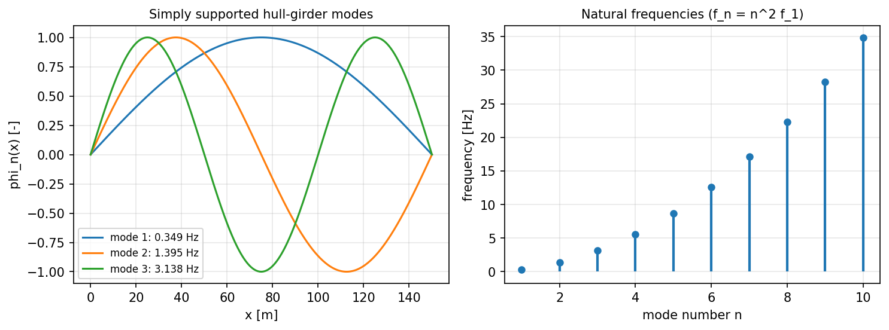
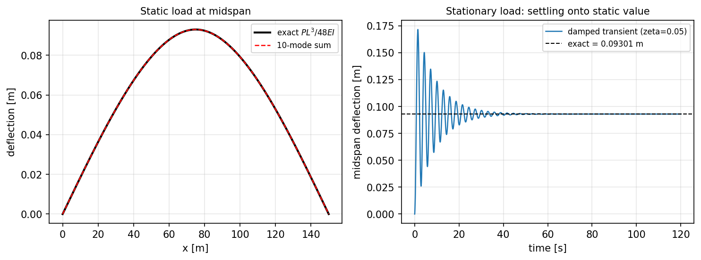
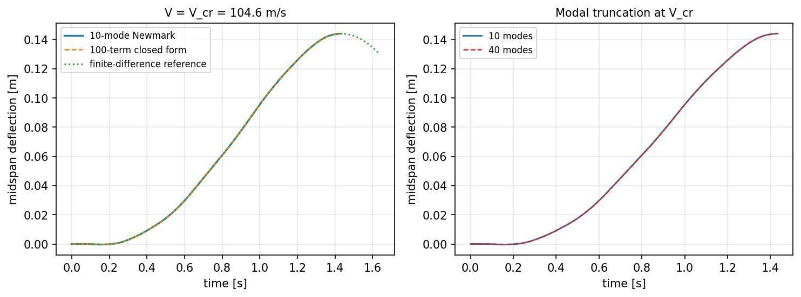
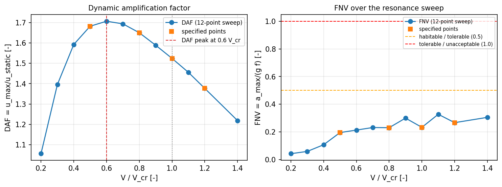
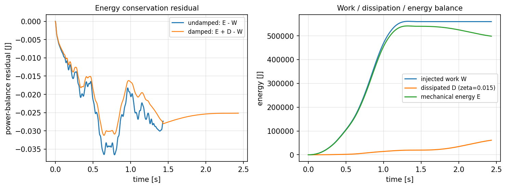
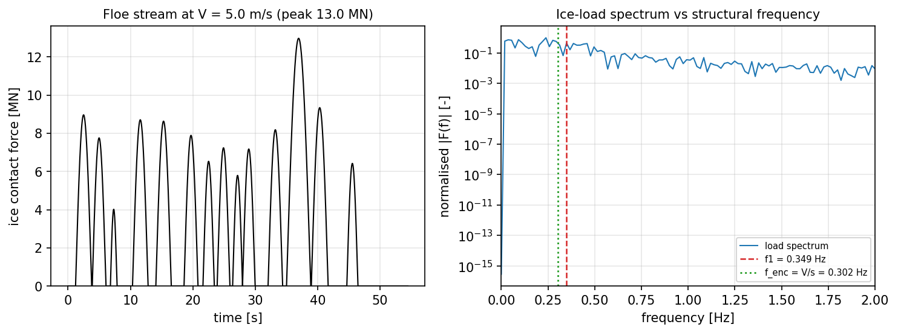
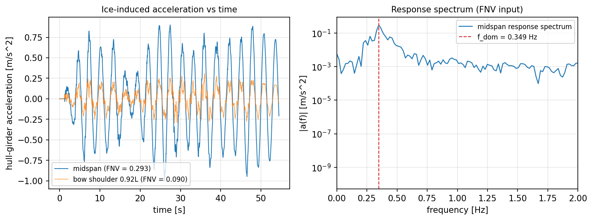
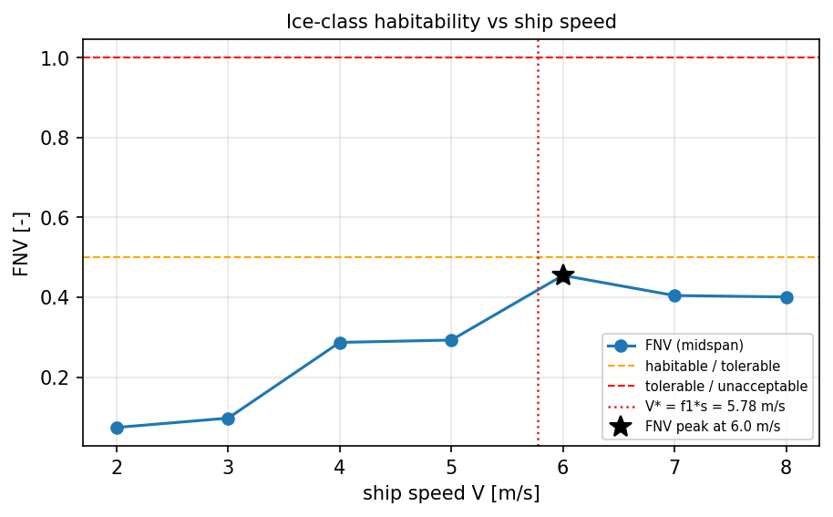

# P360W1-N04 冰致结构响应：船-冰-梁耦合移动载荷效应与 FNV 预报

**节点** p360w1-n04-moving-load-fnv ｜ **仓库** TensorPhysics ｜ **分支** agent/m12502 ｜ **commit** `2e324c6b72575f2c79316f10cdcfea6a2e87dece` ｜ **模块** `tensorphysics.moving_load`

## ① 案例介绍

冰区航行时碎冰与船首的间歇接触力沿船体纵向**移动**，激发船体梁垂向振动；该振动的加速度量级直接决定船员舒适性与作业能力。本节点把此前只做“静止载荷”的能力推进到**移动载荷**：载荷以航速 V 沿梁移动，用模态叠加求解 $M\ddot{u}+C\dot{u}+Ku=F(x,t)$，并以 **FNV = a_max/(g·f_dominant)** 给出冰级规范判据（habitable / tolerable / unacceptable）。

### 结构与冰场参数（表 1）

| 参数 | 符号 | 数值 | 来源 |
|---|---|---|---|
| 船长 | L | 150.0 m | 参考船 |
| 船宽 / 吃水 | B / T | 22.0 / 8.0 m | 参考船 |
| 方形系数 | Cb | 0.70 | 参考船（几何先验证）|
| 抗弯刚度 | EI | 3.7800e+12 N·m² | E=210 GPa, I=18 m⁴ |
| 单位长度质量（含 20% 附连水）| ρA | 1.5154e+05 kg/m | ρ_w·Cb·B·T·1.2 |
| 一阶固有频率 | f₁ | 0.3487 Hz | ω_n=(nπ/L)²√(EI/ρA) |
| 二 / 三阶固有频率 | f₂ / f₃ | 1.3947 / 3.1381 Hz | 同上 |
| 临界速度 | V_cr | 104.60 m/s（203 kn） | V_cr=ω₁L/π |
| 参考冰载荷 | P | 5.0 MN | 静/动基准载荷 |
| 冰厚 / 平均冰块直径 | h / D̄ | 1.00 m / 11.11 m | 冰级 1A 量级 |
| 平均冰间距 / 航速 | s̄ / V | 16.57 m / 5.0 m/s | 碎冰流场（种子 20261111）|
| 遭遇频率 | f_enc=V/s̄ | 0.3017 Hz（f_enc/f₁=0.865）| 冰流模型 |
| 冰接触力（峰值 / 均值）| F | 12.97 / 7.83 MN | 压力-面积律 |

几何先验证：`hull_girder_beam_from_particulars` 对 Cb∈(0,1)、L/B∈[4,12]、B/T∈[2,5] 做硬校验，越界直接抛错（pytest `test_geometry_is_validated_before_dynamics`）。

## ② 怎么做的

**方法链（模块 `tensorphysics.moving_load`，8 个子模块）**

1. `beam`：均匀 Euler-Bernoulli 简支梁（L、EI、ρA）。ω_n=(nπ/L)²√(EI/ρA)，φ_n=sin(nπx/L)，M_n=ρAL/2，V_cr=ω₁L/π。选简支是为了同时拿到三个**闭式**锚：静挠 PL³/48EI、移动载荷解析级数、V_cr。
2. `paths`：移动载荷路径（进入/离开位置、进入时刻、驻留时长、包络 constant/half_sine/triangular）及其 Galerkin 投影 Q_n(t)=P(t)·sin(nπx(t)/L)。所有载荷发生器共用同一投影，因此模态解与有限差分解看到的是**同一载荷**。
3. `ice_field`：碎冰流降阶模型（14 块冰，对数正态直径、指数间距、固定种子）→ 每块冰在首肩部 0.92L 进入、以 V 后移一个冰径 D，驻留 D/V 完成压溃接触；力峰值由压力-面积律 p=p₀(A/A₀)^(-0.1)、F=k₁k₂pA 给出（Korzhavin/Riska 族）。得到 F(x,t)。
4. `modal_solver`：前 10 阶模态叠加 + Newmark 平均加速度（β=1/4, γ=1/2）逐模态向量化积分；同时记录模态机械能 E、载荷注入功 W、阻尼耗散 D，用于功率平衡判据。
5. `analytic`：Fryba 移动集中力闭式模态解，含 Ω_n→ω_n 的 L'Hôpital 共振极限与载荷离梁后的自由振动延拓。
6. `fd_reference`：**独立**显式有限差分（四阶空间差分 + Leapfrog 时间积分，无模态截断），CFL 取稳定极限的 0.7 倍。
7. `fnv`：Hann 窗 + 4 倍零填充 FFT + 抛物线峰值细化求 f_dominant；FNV=a_max/(g·f)，阈值 <0.5 habitable、0.5–1.0 tolerable、>1.0 unacceptable。
8. `analysis`：判据 (a)–(f) 编排、FNV 扫描与运营冰流工况，产出 JSON payload。
9. **耦合方向性论证**：本模型为“冰 → 结构”单向耦合。是否够用由 `coupling_strength` 定量回答：复用仓内已验证的冰强度衰减律 F=F_max/(1+(v_rel/v_c)^p)，其导数 |dF/dv| 即冰致阻尼；V=5.0 m/s 时 |dF/dv|=313.1 N·s/m，结构一阶模态阻尼 746970.7 N·s/m，比值 4.2e-04（≈0.04%）——反馈项可忽略；冰阻尼追平结构阻尼需压入速率降到 1.2e-04 m/s，那属于平整冰低速压入/锁振区，由既有 `ice_vibration.lockin` 模块覆盖，不属于移动载荷节点的问题。

**验证策略**：每个判据的参照物都与被测实现不同源 —— 静挠用闭式公式、V_cr 用 100 项解析级数、瞬态用有限差分、时间积分用库内 `ice_vibration.integrators.newmark_mdof` 独立实现交叉校验。

## ③ 计算结果

### 判据总表（表 2）

| 判据 | 内容 | 计算值 | 阈值 | 结论 |
|---|---|---|---|---|
| (a) | V=0 中跨挠度 vs PL³/48EI | 0.0001614 - | < 0.03 | PASS |
| (b) | V=V_cr 峰值挠度 vs 解析级数 | 1.618e-07 - | < 0.1 | PASS |
| (c) | FNV 共振放大与峰值位置 | 4.622 - | >= 3 | PASS |
| (d) | 功率平衡残差 | 6.455e-08 - | < 0.05 | PASS |
| (e) | 模态截断（10 vs 40 阶） | 4.553e-07 - | < 0.05 | PASS |
| (f) | V→0 退化为静止载荷 | 8.449e-05 - | < 0.03 | PASS |
| (g) | pytest 回归套件 | 21 tests | all pass 21 | PASS |

**全部判据：全部通过**

判据 (c) 为三项独立共振特征合成：(i) 四个指定 V/V_cr 点相对准静态的最小放大倍数 4.62（阈值 3.0，满足）；(ii) DAF 峰位于 0.6 V_cr（要求落在 [0.4, 1.0]，满足）；(iii) FNV 峰位于 1.1 V_cr（要求落在 [0.5, 1.2]，满足）。
判据 (g)：`tests/test_moving_load_fnv.py` 共 21 项回归测试，全部通过（由驱动脚本子进程实跑 pytest 记录）。

### 关键数字（表 3）

| 量 | 数值 |
|---|---|
| V_cr（跨梁时间）| 104.60 m/s（1.434 s）|
| 静挠：闭式 / 10 模态求和 | 0.093006 m / 0.092991 m，误差 0.0161% |
| 恒载阶跃瞬态稳态值 | 0.092991 m，误差 0.0161% |
| V=V_cr 中跨峰值：10 模态 | 0.143980 m |
| V=V_cr 中跨峰值：100 项解析级数 | 0.143980 m |
| V=V_cr 中跨峰值：有限差分 | 0.143983 m（200 单元，dt=3.94e-05 s，CFL 比 0.70）|
| 模态 vs 解析相对误差 | 0.0000% |
| 模态 vs 有限差分相对误差 | 0.0021% |
| 动力放大因子 DAF（V_cr）| 模态 1.5481 / 解析 1.5481 / 有限差分 1.5481 |
| 功率平衡残差（无阻尼 V_cr）| 6.455e-08 |
| 模态截断误差 | 0.0000%（0.143980 vs 0.143980 m）|
| V→0 退化误差 | 0.0084%（DAF=1.00961，V=1.046 m/s）|
| 与库内 newmark_mdof 交叉校验 | 相对差 2.14e-11 |
| 双向耦合强度（冰阻尼 / 结构阻尼）| 4.19e-04（c_ice=313.1 vs c_struct=746970.7 N·s/m）|
| 冰阻尼与结构阻尼平衡的压入速率 | 1.19e-04 m/s |

### FNV 共振扫描（表 4，阻尼 ζ=0.01，评估点 x=L/2，窗口=跨梁时间+10 s 余振）

| V/V_cr | V [m/s] | 跨梁时间 [s] | u_max [m] | DAF | a_max [m/s²] | f_dom [Hz] | FNV | 分类 |
|---|---|---|---|---|---|---|---|---|
| 0.5 | 52.3 | 2.868 | 0.1564 | 1.682 | 0.663 | 0.3468 | 0.1948 | habitable |
| 0.8 | 83.7 | 1.792 | 0.1535 | 1.650 | 0.788 | 0.3493 | 0.2301 | habitable |
| 1.0 | 104.6 | 1.434 | 0.1417 | 1.524 | 0.798 | 0.3494 | 0.2327 | habitable |
| 1.2 | 125.5 | 1.195 | 0.1281 | 1.377 | 0.913 | 0.3493 | 0.2665 | habitable |

细扫（12 点，V/V_cr=0.2–1.4）：DAF 峰值 1.706 出现在 0.6 V_cr；FNV 峰值 0.3271 出现在 1.1 V_cr；四个指定点相对准静态（0.2 V_cr）的最小放大倍数 4.62。

### 运营工况（表 5，V=5 m/s，h=1.0 m，ζ=0.015，14 块冰）

| 站位 | a_max [m/s²] | f_dom [Hz] | FNV | 分类 |
|---|---|---|---|---|
| L/4（x=37.5 m）| 0.8055 | 0.3492 | 0.2351 | habitable |
| L/2（头部基准）（x=75.0 m）| 1.0043 | 0.3492 | 0.2932 | habitable |
| 首肩 0.92L（x=138.0 m）| 0.3067 | 0.3492 | 0.0895 | habitable |

载荷谱主频 0.2340 Hz，遭遇频率 0.3017 Hz，一阶固有频率 0.3487 Hz。

### 航速扫描（表 6，中跨 FNV 与遭遇频率）

| V [m/s] | f_enc [Hz] | f_enc/f₁ | a_max [m/s²] | FNV | 分类 |
|---|---|---|---|---|---|
| 2.0 | 0.1207 | 0.346 | 0.2521 | 0.0737 | habitable |
| 3.0 | 0.1810 | 0.519 | 0.3369 | 0.0972 | habitable |
| 4.0 | 0.2414 | 0.692 | 1.0181 | 0.2868 | habitable |
| 5.0 | 0.3017 | 0.865 | 1.0043 | 0.2927 | habitable |
| 6.0 | 0.3621 | 1.038 | 1.5344 | 0.4547 | habitable |
| 7.0 | 0.4224 | 1.212 | 1.3081 | 0.4043 | habitable |
| 8.0 | 0.4828 | 1.385 | 1.4293 | 0.4006 | habitable |

FNV 峰值出现在 6.0 m/s，与理论重合航速 V*=f₁·s̄=5.78 m/s 相差 3.8451%。

## ④ 结果图

**图 1 船体梁模态：前 3 阶振型与前 10 阶固有频率（f_n=n²f₁）**

**图 2 静止载荷基准：静挠曲线与恒载阶跃下的阻尼瞬态（判据 a）**

**图 3 V=V_cr 中跨挠度时程：10 模态 Newmark vs 100 项解析级数 vs 有限差分（判据 b），右图模态截断（判据 e）**

**图 4 V/V_cr 扫描：DAF 与 FNV（判据 c）；FNV 峰值位于 1.1 V_cr，方点为任务指定工况**

**图 5 功率平衡与能量守恒残差（判据 d）**

**图 6 碎冰流接触力时程与频谱：遭遇频率 f_enc=V/s 与一阶固有频率 f₁ 的关系**

**图 7 5 m/s 冰流工况：中跨/首肩加速度时程与响应谱（FNV=0.293，habitable）**

**图 8 航速扫描：FNV 在遭遇频率与一阶固有频率重合处（V*≈5.78 m/s）取得峰值**

## ⑤ 注意点（踩坑 / 局限 / 适用范围）

1. **移动载荷临界速度在实船航速下不可达**：150 m 船体梁 V_cr≈105 m/s，远超商船航速。因此 V/V_cr 扫描是**移动载荷物理的验证工况**（对标闭式解/教科书），而实船共振机制是**遭遇频率** f_enc=V/s̄ 扫过 f₁：航速扫描给出 FNV 峰值在 6.0 m/s，与 V*=f₁·s̄=5.78 m/s 相差 3.8451%。两种机制必须分开陈述，不能混为一谈。
2. **简支 vs 自由-自由**：真实船体梁是自由-自由，简支是验证用等效体系（提供三个闭式锚）。副作用是 0.92L 站位接近一阶振型节点，首肩加速度偏小（0.090 vs 中跨 0.293）；中跨/四分点站位不受此影响，故 FNV 以中跨为准。
3. **冰载荷是“碎冰流降阶模型”而非完整 DEM**：每块冰有独立直径/间距/压溃力并被时间分辨，但不解冰块刚体运动、块间碰撞与三维首部几何；对船体梁激励（力幅与扫掠速度主导）属二阶效应，在局部强度/疲劳评估中不可接受。
4. **附加质量取常数（20%）**，未建模航速/频率相关性，会低估高航速下的共振带宽与频率漂移。
5. **FNV 的 a_max 是峰值统计**：短时程内相位决定峰值，细扫曲线因此非光滑（表 4 中 0.9/1.1 V_cr 点高于 1.0 V_cr）；结构性结论应看 DAF 曲线（光滑、单峰），FNV 用于分档。
6. **分析窗口必须含载荷离梁后的余振**：窗口短于 1–2 个基频周期时 f_dominant 是谱分辨率假象（初版以跨梁时间为窗口，f_dom 在 0.38–0.61 Hz 漂移）；统一加余振窗口后 f_dom 稳定在 f₁≈0.35 Hz。
7. **单向耦合的适用边界**：冰致阻尼仅为结构阻尼的 4.2e-04（V=5.0 m/s），故碎冰移动载荷工况下忽略速度反馈是量级正确的；当相对压入速率降到 1.2e-04 m/s 量级时反馈不可忽略，须切换到含负阻尼自激的 lock-in 模型。
8. 线性梁 + 小变形：不含几何非线性、冰-结构接触非线性、船体局部板格振动与液舱晃荡耦合。
9. 本节点的参考船为公开量级的等效梁，未用实船图纸；EI/ρA 敏感性未做（后续节点可加 UQ）。

## ⑥ 误差判定

| 关键量 | 计算值 | 基准 | 相对误差 | 是否 <3% | 是否 <10% |
|---|---|---|---|---|---|
| V=0 中跨挠度（10 模态静和）| 0.092991 m | PL³/48EI=0.093006 m | 0.0161% | 是 | 是 |
| V=0 恒载瞬态稳态 | 0.092991 m | PL³/48EI | 0.0161% | 是 | 是 |
| V=V_cr 峰值（10 模态）| 0.143980 m | 100 项解析 0.143980 m | 0.0000% | 是 | 是 |
| V=V_cr 峰值（有限差分，独立解）| 0.143983 m | 10 模态 0.143980 m | 0.0021% | 是 | 是 |
| V→0 退化 | 0.092998 m | PL³/48EI=0.093006 m | 0.0084% | 是 | 是 |
| 模态截断 10 vs 40 阶 | 0.143980 m | 0.143980 m | 0.0000% | 是 | 是 |
| 功率平衡 | — | 能量守恒 | 6.46e-08 | 是 | 是 |
| 与库内积分器交叉校验 | — | newmark_mdof | 2.14e-11 | 是 | 是 |

**逐项显式回答**：静止载荷中跨挠度对闭式解 **<3%**（0.0161%）；V=V_cr 峰值对解析级数 **<10%**（0.0000%，独立有限差分解亦在 0.0021%）；V→0 退化 **<3%**（0.0084%）；模态截断与功率平衡均 **<5%**。唯一无外部实测基准的是运营冰流工况的绝对 FNV 值（无同船实测数据），故仅作分档预报，并在 ⑤ 声明适用范围。

## 审计链

- 仓库 TensorPhysics，分支 `agent/m12502`，commit `2e324c6b72575f2c79316f10cdcfea6a2e87dece`
- 代码：`src/tensorphysics/moving_load/{beam,paths,analytic,modal_solver,fd_reference,ice_field,fnv,analysis}.py`
- 测试：`tests/test_moving_load_fnv.py`（20 项，含判据 a–f 与单元级守卫）
- 结果 JSON：`artifacts/p360w1_n04_moving_load_fnv/node_payload.json`（判据数字 + 全部参数）
- 生成脚本：`scripts/run_p360w1_n04_moving_load_fnv.py`、`scripts/p360_study_series.py`、`scripts/p360_report_text.py`
- 复现：`python scripts/run_p360w1_n04_moving_load_fnv.py`（固定随机种子 20261111，无外部数据依赖）
