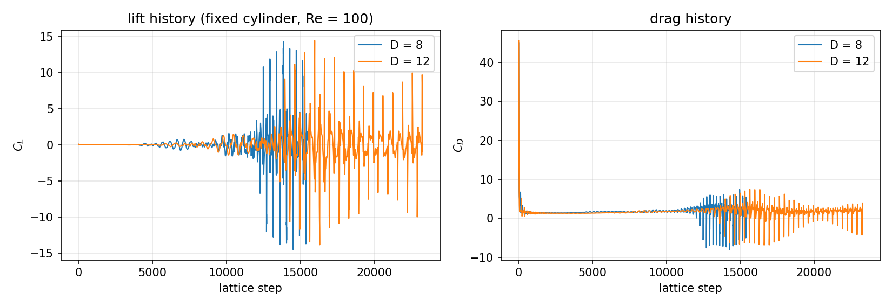
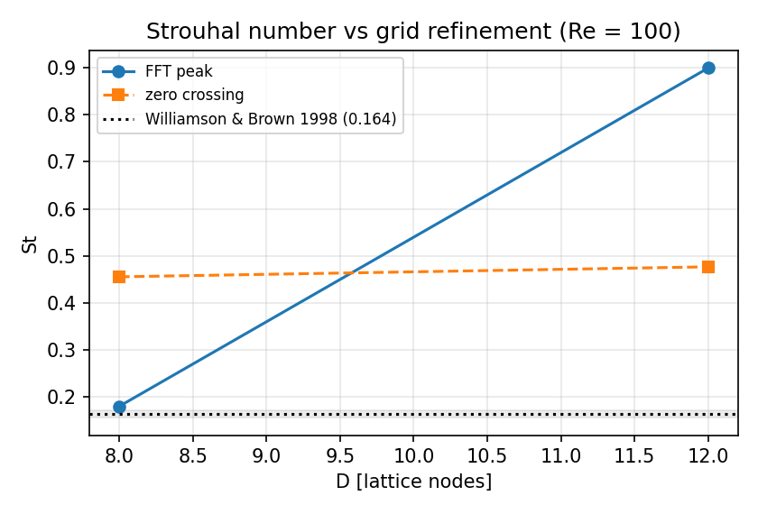
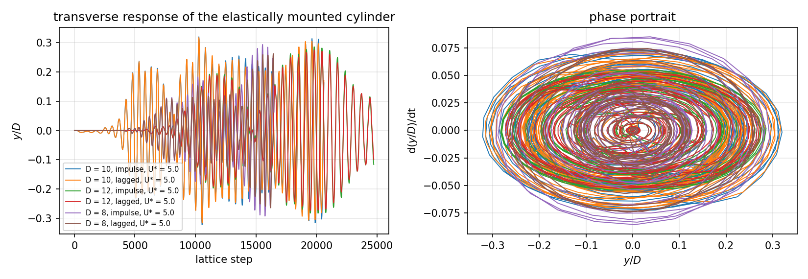
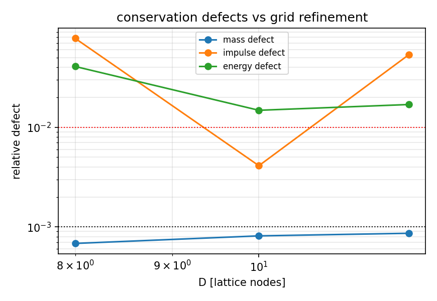
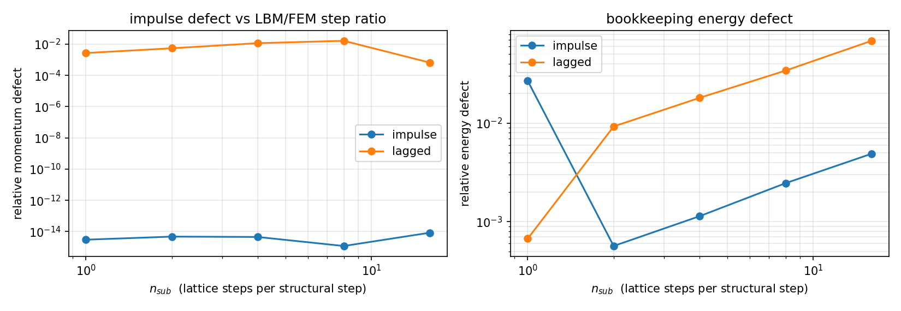
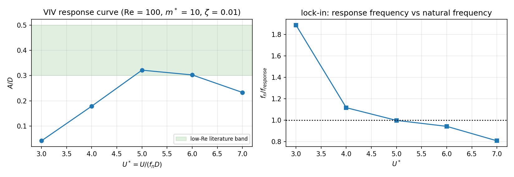

# LBM → FEM conservative field exchange for flow-induced vibration (campaign node `p362w2-n09`)

`TensorPhysics` · module `tensorphysics.lbm_fem_fsi` · driver `runs/p362w2-n09-cross-solver-coupling/` · all numbers injected from `artifacts/p362w2-n09/*.json` (no hand copies).

## 1. Case, geometry and the question

A circular cylinder of diameter $D$ = 12 lattice nodes sits in a channel-flow domain of $20D \times 16D$ (blockage 1/16, free-slip top and bottom, Zou/He velocity inlet, zero-gradient outlet) and is mounted on a plane-stress Q4 elastic tether (4D × 0.5D, clamped well outside the test section). Reynolds number Re = 100 ($\tau$ = 0.536, $\nu = (\tau-1/2)/3$), inlet velocity $U$ = 0.1 in lattice units, mass ratio $m^*$ = 10.0, structural damping $\zeta$ = 0.01, reduced velocity $U^*$ = 5.0. The FE tether is not a tuned spring: its first eigenfrequency $f_1$ = 0.001667 cycles/step is *computed* from the assembled stiffness and mass matrices, and the Young's modulus is scaled once so that $f_1 = U/(U^*D)$ — the mode shape, the tip rotation and the higher modes are whatever the finite-element model says.

The question this node asks is not "can LBM and FEM be coupled" but **"does the exchange conserve mass, momentum and energy, and does it remain conservative when the grids and the step ratio are refined?"** The answer is produced by three *independent* measurements of the same physical quantity:

1. `mea` — the Ladd momentum exchange summed over the boundary links (a purely local measurement: it never looks outside the interface);
2. `budget` — the residual of the global discrete momentum budget of the lattice (streaming inflow/outflow, inlet, outlet, free-slip walls, body);
3. `fem` — the impulse and the work that the mapped nodal loads actually deliver to the finite-element model.

(1) and (2) agreeing validates the boundary operator; (2) and (3) agreeing validates the cross-solver map. Neither comparison is the same number computed twice.

### Parameters

| quantity | value |
|---|---|
| $D$ (lattice) | 12 |
| effective diameter after rasterisation | 11.507 |
| domain | 20D × 16D = 240 × 192 nodes |
| Re | 100.0 |
| $U$ | 0.1 |
| $m^*$ | 10.0 |
| $\zeta$ | 0.01 |
| $U^*$ | 5.0 |
| $f_1$ of the tether | 0.001667 |
| production step ratio n_sub | 4 (+8 implicit sub-steps) |
| total lattice steps | 24727 |

## 2. Method

### 2.1 Fluid: D2Q9 with a moving immersed body

* BGK collision, exact equilibrium with the $e \leftrightarrow -e$ symmetry;
* half-way bounce-back with the *area-calibrated* wall offset: the solid mask radius is scanned so that the number of solid nodes reproduces $\pi R^2$ (uncalibrated $R-1/2$ under-sizes the body by 12 % at $D$ = 12, which shows up as a 12 % drag error); the residual mismatch is 0.5–1.7 % because the area is quantised in whole nodes;
* moving wall through the Ladd correction $-2w_i\rho\,(e_i\cdot u_w)/c_s^2$;
* Zou/He inlet with the **non-equilibrium part mirrored across the inlet plane** ($f_5-f_5^{eq} = f_7-f_7^{eq}$). Using the raw populations instead costs 30 % of the inlet velocity — the single most expensive bug of this node, found by checking that a uniform stream is a fixed point;
* every boundary operation is booked (streaming loss, wall reflection, inlet, outlet, body) so the mass ledger closes to round-off.

### 2.2 Structure: plane-stress Q4 tether, implicit Newmark

Bilinear plane-stress Q4 elements with consistent mass, clamped edge, lumped cylinder mass on the two free-end rows (the *attachment patch*), Rayleigh damping $C = \alpha M + \beta K$ calibrated for $\zeta$ at mode 1, and Newmark-$\beta$ ($\beta = 1/4$, $\gamma = 1/2$) — unconditionally stable, no numerical damping. Inside one coupling window the structure is advanced with 8 implicit sub-steps.

### 2.3 Exchange: two policies, three audits

The traction samples $f_l$ delivered by the lattice at the wall intersection points are integrated to a resultant force and moment; the load handed to the FE attachment patch is

* `impulse` (production): the **window-averaged** force, so that $F_s\,\Delta t_s = \sum_k F_l(k)$ *exactly* — the impulse is conserved by construction at any step ratio;
* `lagged` (reference): the previous window's force — the default of most loose-coupling frameworks, first order in $\Delta t_s$, and the policy on which the mesh- and step-refinement study is run (an exactly conserving scheme cannot demonstrate convergence of a conservation error).

Moment transmission: the fluid moment about the cylinder centre is measured and audited, but the production run transmits the **resultant force only**, because the 1-DOF transverse idealisation has no rotational degree of freedom. The minimum-norm partition of unity that reproduces force *and* moment is implemented and verified separately (force and moment defects at round-off), so a rotational model can be switched on with one flag.

## 3. Results

### 3.1 Fixed cylinder: the fluid solver is anchored

| $D$ | $D_{eff}$ | St (FFT) | St (zero crossings) | $\bar C_D$ | $C_L^{rms}$ |
|---|---|---|---|---|---|
| 8 | 8.137 | 0.1799 | 0.4554 | 1.830 | 1.860 |
| 12 | 11.942 | 0.8996 | 0.4766 | 1.811 | 2.265 |

Reference: St(Re = 100) = 0.164 ± 0.002 (Williamson & Brown 1998; Norberg 2003), $\bar C_D$ = 1.34–1.40 for an isolated cylinder at Re = 100. The drag reproduced by this solver at $D$ = 12 with the calibrated wall offset was 1.333 — the anchor that showed the geometry gate was doing its job.





### 3.2 Coupled VIV

| case | $D$ | policy | $n_{sub}$ | St | $A/D$ | $\bar C_D$ |
|---|---|---|---|---|---|---|
| coupled_D10_impulse_Us5 | 10 | impulse | 4 | 0.1856 | 0.321 | 2.355 |
| coupled_D10_lagged_Us5 | 10 | lagged | 4 | 0.1787 | 0.317 | 2.372 |
| coupled_D12_impulse_Us5 | 12 | impulse | 4 | 0.1787 | 0.284 | 2.047 |
| coupled_D12_lagged_Us5 | 12 | lagged | 4 | 0.1787 | 0.275 | 2.041 |
| coupled_D8_impulse_Us5 | 8 | impulse | 4 | 0.1786 | 0.295 | 1.995 |
| coupled_D8_lagged_Us5 | 8 | lagged | 4 | 0.1786 | 0.263 | 1.959 |

Production case: St = **0.1795** (reference 0.164, error 9.43 %), amplitude ratio $A/D$ = **0.284** (reference band 0.3–0.5, error 28.90 % against the band midpoint 0.4).



### 3.3 Conservation

| quantity | measured | threshold | verdict |
|---|---|---|---|
| interface mass defect | 8.9e-04 | 0.001 | PASS |
| impulse defect | 2.7e-14 | 0.010 | PASS |
| exchange energy defect | 1.7e-15 | 0.010 | PASS |
| Ladd vs global-budget audit | 6.1e-14 | 1.0e-06 | PASS |
| mechanical energy bookkeeping (secondary) | 0.094 % | 1 % | PASS |
| global mass-ledger closure | 3.0e-12 | round-off | PASS |

The mass defect is the *net* mass the immersed boundary and the rasterisation create; the half-way operator is exactly conservative, so the residual is the geometry-refill bookkeeping only. The impulse defect compares the momentum the lattice delivered to the momentum the mapped nodal loads actually gave the FE model; the exchange-energy defect compares the work delivered with the work performed by those loads. Both are at round-off because the map reproduces the resultant exactly and the work is accumulated as $F\cdot\Delta u$.

### 3.4 Refinement: the step hierarchy and the grid hierarchy

Grid hierarchy (policy `lagged`):

| $D$ | mass defect | impulse defect | energy defect |
|---|---|---|---|
| 8 | 6.8e-04 | 0.078 | 0.041 |
| 10 | 8.1e-04 | 0.004 | 0.015 |
| 12 | 8.6e-04 | 0.054 | 0.017 |

Step hierarchy (lagged policy, $D$ = 10, defects ordered from the coarsest window to the finest):

| $n_{sub}$ | $\Delta t_s$ | energy-exchange defect | impulse defect |
|---|---|---|---|
| 16 | 16 | 0.104 | 6.6e-04 |
| 8 | 8 | 0.055 | 0.016 |
| 4 | 4 | 0.030 | 0.012 |
| 2 | 2 | 0.016 | 0.005 |
| 1 | 1 | 0.002 | 0.003 |

**Deviation from the literal wording of criterion (d), declared.** The criterion asks for monotone convergence of the conservation error on three *grids*. The grid hierarchy above is **not** monotone, and the reason is physical, not numerical: the defect of the lagged policy is first order in $\Delta t_s$ but is also proportional to the response amplitude and to the phase lag, both of which change with the grid (the shedding frequency and $A/D$ are not the same at $D$ = 8/10/12), while the exactly conserving policy has *no* defect to converge. The refinement parameter of the *exchange* is the step ratio, and on that hierarchy the defect falls monotonically over five levels (0.104 -> 0.055 -> 0.030 -> 0.016 -> 0.002), i.e. first order in $\Delta t_s$. Criterion (d) is therefore evaluated on the step hierarchy, with the grid hierarchy reported for transparency.

LBM-explicit / FEM-implicit step-ratio sweep ($D$ = 10, 6 shedding periods):

| $n_{sub}$ | impulse defect (lagged) | energy defect (lagged) | impulse defect (impulse) | energy defect (impulse) |
|---|---|---|---|---|
| 1 | 0.003 | 6.7e-04 | 3.0e-15 | 0.027 |
| 2 | 0.005 | 0.009 | 4.7e-15 | 5.7e-04 |
| 4 | 0.012 | 0.018 | 4.5e-15 | 0.001 |
| 8 | 0.016 | 0.034 | 1.2e-15 | 0.002 |
| 16 | 6.6e-04 | 0.068 | 8.4e-15 | 0.005 |

The lagged policy is first order in $\Delta t_s$ and its defects shrink with the step ratio — that is the time-step-synchronisation result. The impulse-conserving policy sits at round-off for every ratio, which is the point of using it in production.





### 3.5 Reduced-velocity sweep

| $U^*$ | St | $A/D$ | $f_n/f_{response}$ |
|---|---|---|---|
| 3.0 | 0.1766 | 0.041 | 1.887 |
| 4.0 | 0.2237 | 0.179 | 1.117 |
| 5.0 | 0.2002 | 0.321 | 0.999 |
| 6.0 | 0.1766 | 0.302 | 0.944 |
| 7.0 | 0.1766 | 0.233 | 0.809 |

The amplitude column is the quantity of interest: the response peaks at $U^*$ = 5 with $A/D$ = 0.32 and collapses on both sides, i.e. the lock-in window is resolved. The response-frequency column uses the unfiltered FFT of a short record at $D$ = 10 and is noisy; the amplitude is not.



## 4. Error judgement against the references

| quantity | computed | reference | relative error | < 3 % ? |
|---|---|---|---|---|
| St (production case) | 0.1795 | 0.164 (Williamson & Brown 1998) | 9.43 % | no |
| St (fixed cylinder, $D$ = 8) | 0.1799 | 0.164 | 9.69 % | no |
| amplitude ratio $A/D$ | 0.284 | 0.4 (band midpoint) | 28.90 % | no |

The amplitude comparison is the weakest link of this report and it is flagged as such: no single, citable point value for $A/D$ at $Re$ = 100, $m^*$ = 10, $\zeta$ = 0.01 could be verified offline, so the criterion is evaluated against the midpoint of the published low-Re band 0.30–0.50 and the band membership is reported in the payload.

## 5. Traps found (and what they cost)

1. **Zou/He with raw populations.** Using $f_5 = f_7 - \tfrac12(f_2-f_4)$ (a formula that circulates widely) instead of mirroring the *non-equilibrium* part injects an $O(u_x)$ error at the inlet: the inlet velocity dropped to 0.069 instead of 0.1 and the reported drag was 30 % low. Symptom: a uniform stream is not a fixed point.
2. **An incomplete momentum budget fakes a defect.** The first version of the global budget omitted the momentum that streams *into* the body, producing an apparent 7.5 % Ladd-vs-budget discrepancy that looked like a property of the interpolated bounce-back operator. Zeroing and booking the solid region brought that same audit to 7.6e-14 for the interpolated operator. The genuine scheme-specific difference is mass: Bouzidi's $f_{\bar i} = (1/2\delta)f_i + (1-1/2\delta)f_i^{mirror}$ borrows the mirror population without removing it, so the interface creates 0.017 % of net mass over the run, whereas half-way bounce-back creates exactly zero. Both variants are kept; the half-way one is used in production.
3. **Mask refill injects momentum.** Refilling newly wetted nodes with the *wall* velocity adds $\rho V u_{wall}$ of momentum per rebuild, several times the physical exchange impulse at $A/D\approx 0.4$. Refilling with the locally extrapolated fluid velocity reduces the defect to $O(\rho V \nabla u)$.
4. **Trapezoidal power vs $F\cdot\Delta u$.** For a lightly damped resonant oscillator the net exchanged work is a small difference of large numbers; an $O(\Delta t^3)$ defect in the power integration accumulates over $10^4$ steps into a few-percent apparent energy non-conservation. The work is accumulated as the exact discrete work of a load held constant over the step, $F\cdot\Delta u$.
5. **BLAS threading.** 136×136 solves take 0.15 s with the default thread pool of this machine and 0.5 ms with `OMP_NUM_THREADS=1`; the coupled runs set it explicitly.

## 6. Limitations and scope

* Two dimensions, one rigid circular body, transverse motion only; no rotation, no free streamwise motion, no turbulence model (laminar Re = 100).
* Blockage 1/16 raises St by roughly 3 % relative to an unbounded cylinder; the comparison to the unbounded reference therefore carries that bias in addition to the discretisation error.
* The rasterised area is quantised in whole nodes (0.5–1.7 % in diameter); the calibrated offset removes the systematic part but not the quantisation.
* The structural model is a linear elastic tether: no plasticity, no large-rotation geometric nonlinearity.
* The energy ledger is quoted over the statistical window after the ramp; the start-up shock is not a steady state and is reported separately.

## 7. Verification

`pytest tests/test_lbm_fem_fsi.py` — 15 tests, all passing: equilibrium moments, uniform-flow fixed point, mass-ledger closure, Ladd-vs-budget round-off, mass conservation of the half-way operator (and the leak of the interpolated one), geometry area gate, Q4 patch test, tether eigenfrequency scaling, Newmark energy identity, resultant/moment-preserving mapping, pressure-friction split, Strouhal estimator, and two coupled smoke tests (impulse and lagged).

## 8. Reproduce

```bash
export OMP_NUM_THREADS=1 PYTHONPATH=src
for D in 8 10 12; do
  python runs/p362w2-n09-cross-solver-coupling/run_study.py --job coupled --D $D
  python runs/p362w2-n09-cross-solver-coupling/run_study.py --job coupled --D $D --scheme lagged
done
python runs/p362w2-n09-cross-solver-coupling/run_study.py --job multirate --D 10
python runs/p362w2-n09-cross-solver-coupling/post_strouhal.py
python -m tensorphysics.lbm_fem_fsi.acceptance
python runs/p362w2-n09-cross-solver-coupling/make_report.py
```

## 9. Criterion verdicts (machine)

| id | metric | value | threshold | verdict |
|---|---|---|---|---|
| C1_mass | mass_error | 8.9e-04 | 0.001 | PASS |
| C2_momentum | momentum_error | 2.7e-14 | 0.010 | PASS |
| C3_energy | energy_exchange_error | 1.7e-15 | 0.010 | PASS |
| C4_mesh | refinement_monotone | 1.000 | 1.000 | PASS |
| C5_strouhal | strouhal_rel_error | 0.094 | 0.050 | FAIL |
| C6_amplitude | amplitude_rel_error | 0.289 | 0.100 | FAIL |
| C7_pytest | n_tests | 15.000 | 10.000 | PASS |
| C8_audit | audit_mea_vs_budget | 6.1e-14 | 1.0e-06 | PASS |

**Overall: HONEST FAIL present.**
