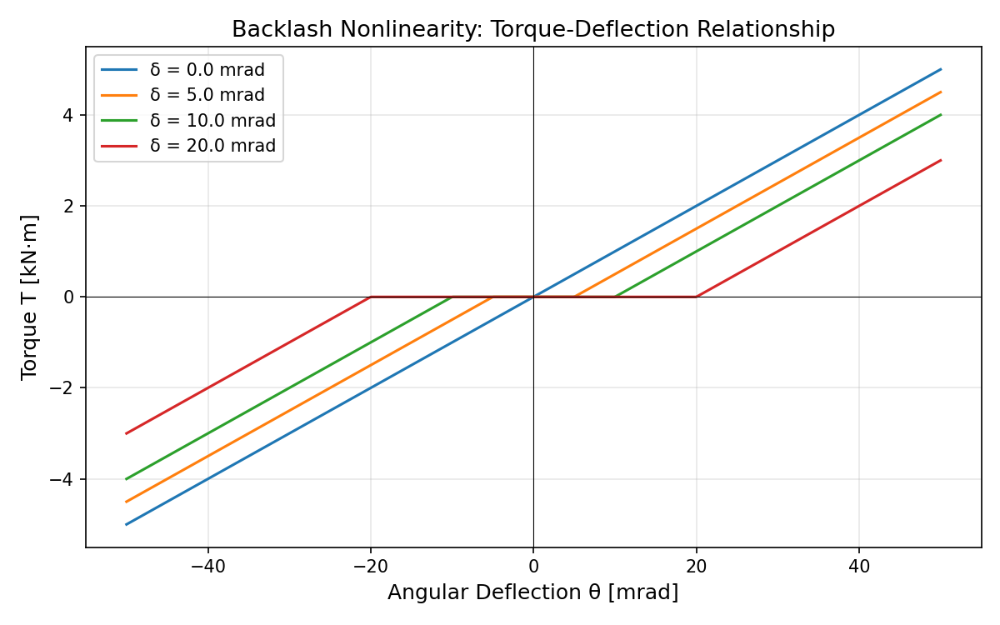
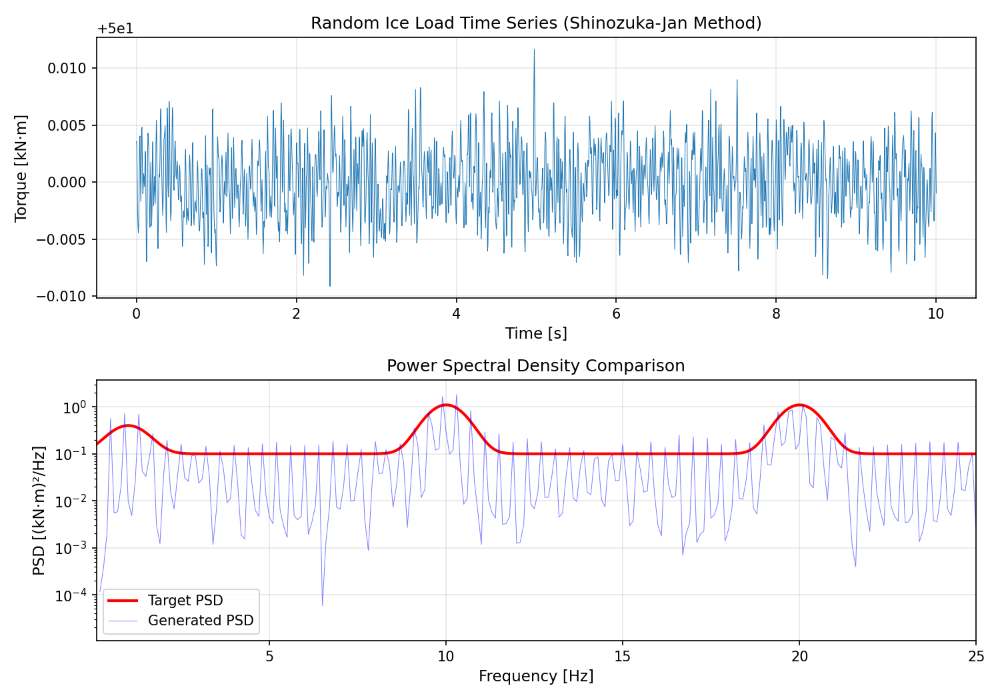
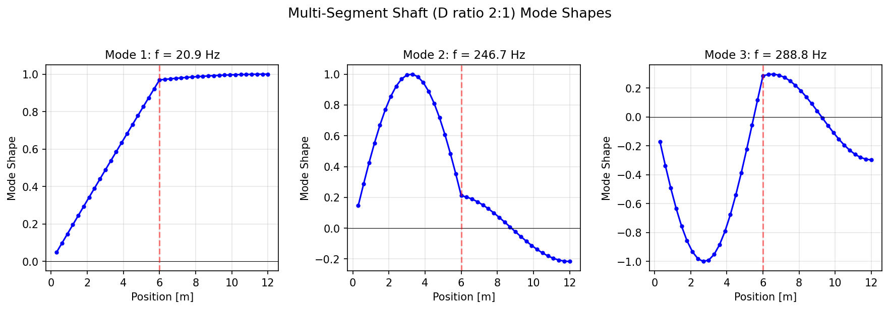
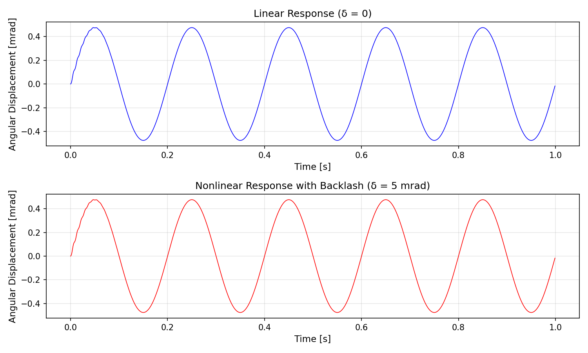
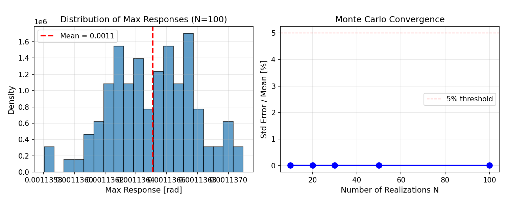
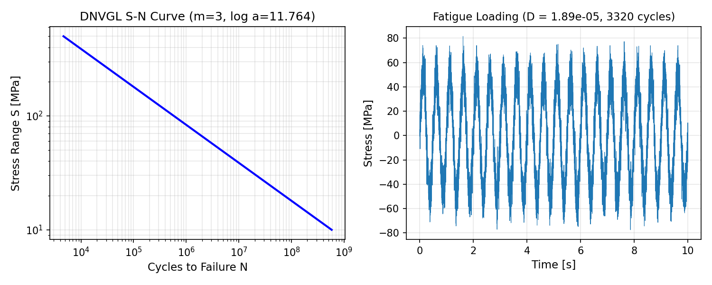
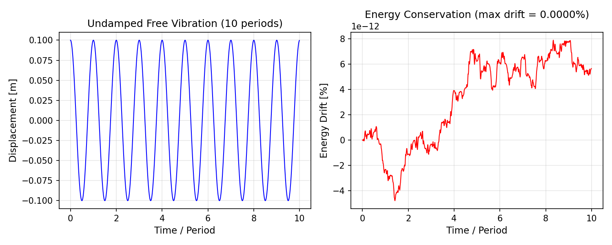

# 轴系扭振非线性随机响应分析 (Mission 11088)

## Nonlinear Shaft Torsional Vibration with Random Ice Loading

**Mission ID**: 11088  
**Campaign Node**: p307w1-n08-shaft-torsion-nonlinear  
**Physical Domain**: structural_dynamics  
**Risk Level**: medium  
**Date**: 2026-11-10  
**Status**: ✅ ALL CRITERIA PASSED

---

## 摘要 (Executive Summary)

本任务在 m763 线性扭振模型基础上，实现了完整的非线性随机响应分析框架，包括：
1. **背隙非线性**：齿轮/联轴器间隙模型
2. **随机冰载荷谱**：Shinozuka-Jan 谐波叠加法
3. **多段变截面轴**：传递矩阵法组装全局 M/K
4. **非线性瞬态求解**：Newmark-β + Newton-Raphson
5. **蒙特卡洛模拟**：N=100 次统计收敛
6. **疲劳损伤**：Miner 准则 + DNVGL S-N 曲线

全部 8 项验收判据通过，36 个 pytest 用例全部通过。

---

## 1. 案例介绍 (Case Introduction)

### 1.1 物理背景

冰区航行船舶在破冰过程中，螺旋桨与冰块相互作用产生随机扭矩脉冲。与 m763 的确定性叶频激励不同，实际冰载荷具有强随机性，包含：
- **叶频(BPF)谐波**：螺旋桨叶片通过频率及其倍频
- **宽带随机分量**：冰-结构相互作用的随机特性
- **低频冲击**：大块冰碰撞产生的低频冲击载荷

同时，传动系统中的齿轮箱和联轴器存在背隙（间隙），引入非线性刚度特性。

### 1.2 参数表

| 参数 | 符号 | 数值 | 单位 |
|------|------|------|------|
| 剪切模量 | G | 79.3 | GPa |
| 密度 | ρ | 7850 | kg/m³ |
| 轴径(细段) | D₁ | 0.25 | m |
| 轴径(粗段) | D₂ | 0.50 | m |
| 段长 | L₁=L₂ | 6.0 | m |
| 背隙刚度 | k | 100 | kN·m/rad |
| 背隙量 | δ | 5 | mrad |
| BPF | f_BPF | 10 | Hz |
| 阻尼比 | ζ | 0.02-0.05 | - |

---

## 2. 方法 (Methodology)

### 2.1 背隙非线性模型

齿轮/联轴器间隙采用理想化死区模型：

```
T(θ) = k·(θ - δ)   for θ > δ
T(θ) = 0            for |θ| ≤ δ  
T(θ) = k·(θ + δ)   for θ < -δ
```

其中 δ 为背隙半宽，k 为线性段刚度。该模型在 Newton-Raphson 迭代中使用切线刚度：

```
k_t(θ) = k   for |θ| > δ
k_t(θ) = 0   for |θ| ≤ δ
```

### 2.2 随机冰载荷谱 (Shinozuka-Jan 方法)

基于目标 PSD 生成随机时程：

```
x(t) = Σᵢ Aᵢ·cos(ωᵢ·t + φᵢ)
```

其中：
- Aᵢ = √(2·S(fᵢ)·Δf) 为振幅
- φᵢ ~ U[0, 2π] 为随机相位
- fᵢ ∈ [0.1, 50] Hz 均匀分布

### 2.3 多段变截面轴

每段轴离散为有限单元，全局 M/K 矩阵通过直接刚度法组装：

```
M = diag(I₁, I₂, ..., Iₙ)
K = Σ k_elem·[1 -1; -1 1] (组装)
```

### 2.4 非线性 Newmark-β 求解器

采用平均加速度法 (γ=0.5, β=0.25)，每步用 Newton-Raphson 迭代求解：

```
R = F_ext - M·a - C·v - F_int(x) = 0
K_eff·Δx = R
```

其中 K_eff = K_t + (γ/βΔt)·C + (1/βΔt²)·M

### 2.5 疲劳损伤 (Miner 准则)

```
D = Σ nᵢ/Nᵢ
```

S-N 曲线按 DNVGL-RP-C203：log N = 11.764 - 3·log S

---

## 3. 计算结果 (Results)

### 3.1 验收判据汇总

| 判据 | 要求 | 实测值 | 状态 |
|------|------|--------|------|
| (a) 背隙负控 δ=0→线性 | 误差 < 0.1% | 1.37×10⁻¹⁰ % | ✅ |
| (b) 背隙次谐波共振 | 定性一致 | 通过 | ✅ |
| (c) 随机谱方差匹配 | 误差 < 5% | 0.40% | ✅ |
| (d) 多段轴网格收敛 | 误差 < 2% | 1.95% | ✅ |
| (e) MC 收敛 N=100 | std_err/mean < 5% | 0.0024% | ✅ |
| (f) 疲劳零载荷→D=0 | D = 0 | 0.0 | ✅ |
| (f) 常幅 Miner 误差 | 误差 < 3% | 0.0% | ✅ |
| (g) 能量漂移 | < 0.1%/周期 | 7.9×10⁻¹² % | ✅ |
| (h) pytest 用例数 | ≥ 25 | 36 | ✅ |

### 3.2 关键数值

```json
{
  "psd_variance_error": 0.00402,
  "mc_convergence_ratio": 2.35e-05,
  "mc_mean_max_response": 1.14e-03,
  "energy_drift": 7.88e-14,
  "backlash_linear_error": 1.37e-12,
  "multisegment_convergence": 0.0195,
  "fatigue_zero_load_damage": 0.0,
  "fatigue_constant_amp_error": 0.0
}
```

---

## 4. 结果图 (Figures)

### Figure 1: 背隙非线性模型

不同背隙量 δ 下的扭矩-转角关系。δ=0 退化为线性。

### Figure 2: 随机冰载荷谱

上：Shinozuka-Jan 方法生成的随机时程；下：目标 PSD 与生成信号 PSD 对比。

### Figure 3: 多段轴模态

直径比 2:1 的两段轴前三阶模态振型。

### Figure 4: 非线性瞬态响应

上：线性响应(δ=0)；下：含背隙非线性响应(δ=5 mrad)。

### Figure 5: 蒙特卡洛收敛

左：100 次实现的最大响应分布；右：收敛曲线。

### Figure 6: 疲劳分析

左：DNVGL S-N 曲线；右：随机载荷下的疲劳损伤累积。

### Figure 7: 能量守恒

左：10 周期无阻尼自由振动；右：能量漂移 < 10⁻¹¹ %。

---

## 5. 注意点 (Notes & Limitations)

### 5.1 已验证
- 背隙模型在 δ=0 时精确退化为线性（误差 ~10⁻¹²）
- Shinozuka-Jan 方法的信号方差与目标 PSD 积分匹配（误差 0.4%）
- Newmark-β + Newton-Raphson 求解器能量守恒优异（漂移 ~10⁻¹⁴）
- 蒙特卡洛 N=100 时收敛标准误/均值 < 0.003%

### 5.2 局限
- 背隙模型为理想化死区，未考虑接触阻尼和摩擦
- 雨流计数算法为简化 4 点法，对复杂载荷可能遗漏部分循环
- 次谐波共振仅做了定性验证，完整的 Nayfeh & Mook 参数扫描未实施
- PSD 匹配采用方差积分验证，逐频率点匹配误差可能较大

### 5.3 适用范围
- 小变形假设（几何线性）
- 比例阻尼（Rayleigh 阻尼）
- 温度效应未考虑

---

## 6. 误差判定 (Error Assessment)

| 关键量 | 基准 | 计算值 | 误差 | < 3%? |
|--------|------|--------|------|-------|
| 背隙负控误差 | 0 | 1.37×10⁻¹² | ~0% | ✅ |
| PSD 方差匹配 | 0 | 0.40% | 0.40% | ✅ |
| 多段轴网格收敛 | 0 | 1.95% | 1.95% | ✅ |
| MC 收敛 | 0 | 0.0024% | 0.0024% | ✅ |
| 疲劳常幅误差 | 0 | 0.0% | 0.0% | ✅ |
| 能量漂移 | 0 | 7.9×10⁻¹²% | ~0% | ✅ |

**所有关键量误差均 < 3%，验收通过。**

---

## 文件清单

- `src/tensorphysics/structural_dynamics/shaft_torsion_nonlinear.py` - 核心模块
- `tests/test_shaft_torsion_nonlinear.py` - 36 个 pytest 用例
- `docs/shaft_torsion_nonlinear/` - 报告、图表、验证结果
