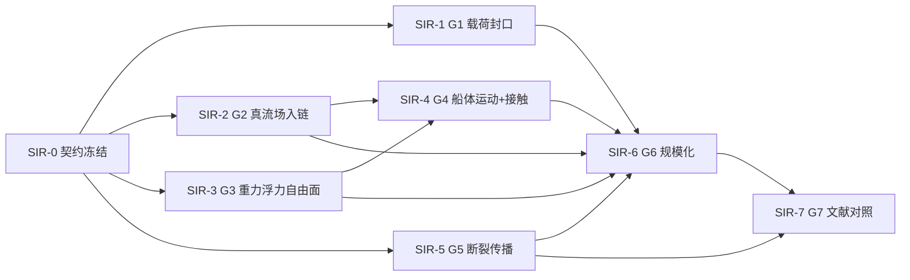

# suboff_icebreaking —— 完整 SUBOFF 破冰战役

owner 指令（2026-10-21）：围绕完整的 SUBOFF 破冰，把 TensorLBM / TensorFVM 的
流体功能、TensorFEM 的有限元功能、TensorDEM 的离散元功能都开发到位。

目标场景：**全附体 SUBOFF 潜艇**（sail + 尾舵 + 轴向附体）在冰区近水面航行，
顶升破断连续冰板，碎冰在流体载荷下演化——流体（LBM+FVM 双路）、结构（FEM
冰板弹性+断裂）、离散（DEM 碎冰接触+湿耦合）三物理双向耦合的完整模拟。

## 库分工

| 库 | 角色 | 战役内能力目标 |
|---|---|---|
| TensorLBM | 流体（格子 Boltzmann） | SUBOFF 全附体近水面/冰面下外流；自由面；冰下流道 |
| TensorFVM | 流体（有限体积 body-fitted/RANS） | SUBOFF 贴体外流；与 LBM 跨库互证；可交换流体腿 |
| TensorFEM | 结构（有限元） | 连续冰板：弹性地基板 + cohesive 断裂；破冰载荷学 |
| TensorDEM | 离散（离散元） | 碎冰块：接触/恢复/浮沉/湿耦合；碎冰场演化 |
| TensorPhysics | 场景编排 | 适配器+耦合账本+阶梯判据（wedge 范式继承） |

## 阶梯（每阶 prereg 先冻结后跑；判据全机器裁定）

### Phase 0 —— 能力审计（SI-0，四腿并行，纯读）
每库产出 `scenarios/suboff_icebreaking/audits/SI-<X>-<lib>.md`：
现有模块清单对照战役需求 → 差距清单（按阻断性排序）→ 每差距提议解析锚
（可机器裁定）→ 工作量分级。**禁止审计腿写功能代码。**

### Phase 1 —— 单库能力到位（SI-A/B/C/D）
- **SI-A TensorLBM 流体腿**：全附体近水面流场。锚：①已 verified 的 sail 线
  阻力基线复现；②冰面（顶盖滑移/无滑移）下通道流解析解；③自由面既有锚。
- **SI-B TensorFVM 流体腿**：SUBOFF 贴体网格+外流。锚：①阻力量级 vs
  ITTC-1957 参考带；②与 SI-A 同工况跨库互证门（约定口径与容差）。
- **SI-C TensorFEM 冰板腿**：①弹性地基板静载 Hetényi 级数解；②cohesive
  断裂能量账本机器精度（wedge S1 双账本范式）；③板-水附加质量量级锚。
- **SI-D TensorDEM 碎冰腿**：①单块浮沉（浮力=重力+衰减到静平衡）；
  ②两块碰撞恢复系数标定/复现；③湿耦合阻力锚（calibrated_wet_coupling 线）。

### Phase 2 —— 耦合阶梯（依赖有序）
- **SI-1 LBM×FEM 单向**：流载→冰板响应；节点力账本 max|对账差| 机器精度门。
- **SI-2 FEM→DEM 断裂生成**：cohesive 破坏单元→DEM 颗粒；质量/断裂能量
  守恒门（生成前后账本差 ≤ 机器精度级）。
- **SI-3 DEM×流体双向**：wedge S4 闭环交换技术的 SUBOFF 版（主/子时钟比率
  与交换节拍显式；冲量双账本）。
- **SI-4 全链演示**：SUBOFF 顶破冰板完整演化；论文级平台报告（物理表述+
  云图+曲线+审计+局限披露）。
- **SI-5 FVM 对照腿**：同一冰况下 FVM 替换 LBM 流体腿的可交换性（适配器
  接口契约门）。

## 纪律（全部沿用既有范式）

- prereg append-only，判据先冻结后跑；判决数字零手抄（值-文件-键三元组
  gates.json，派发器复算未过不推）。
- 双账本对账（力/冲量/断裂能量）机器精度级；跨跑逐位门禁用（#268 DG0 教训）。
- GPU 纪律：GPU5 唯一（CUDA_VISIBLE_DEVICES=5），GPU5_BUSY 协议排队；
  B 线算力在飞时本战役计算腿先走 CPU 锚。GPU0-4 他人服务禁碰。
- 长计算 nohup 分离 + DONE.json 完成清单（launch-harvest 分离）。
- merge 留 owner；合格自动推送（commit+门绿亲验+审批过+记录净）。
- 时区：所有 prereg/报告时间戳 UTC Z 后缀（dispatch 日志 CST 标 Z 教训）。

## 与既有线的关系

- **wedge_icebreaking**：技术先导线。S0-S3 已闭环；**S4（闭环双向交换）是
  SI-3 的直接前置**，随本战役重启（中继恢复后重派）。
- **suboff_sail**：SUBOFF 几何与 LBM 流体基础的 verified 来源（SI-A 复用）。
- **B 线 benchmark closure**：互不阻断（GPU 排队协调）。

## 定向修订（2026-10-21，owner）：库优先——以破冰带动求解器深度开发

**原则**：SUBOFF 破冰战役的目的是带动四个求解器库的深度开发，不是停留在纸面案例。每个 SI 阶段的求解器能力必须落在对应库的 `src/` + `tests/`（TensorFEM/TensorDEM/TensorLBM/TensorFVM）；TensorPhysics 场景目录只允许薄编排、双账本与验证锚。与求解器相关的开发（性能/规模化/数值稳健性/文档）都在战役范围内。

**SI-1 矫正（SI-1b，待 PR #46 合后执行）**：场景内 `plate_response.py` 板单元升库 TensorFEM（`src/tensorfem/plate_mindlin.py`），场景改为 import 库，消除场景内副本；SI-1 三锚全绿重跑。

**SI-2 重切（2026-10-21 生效）**：拆两库开发腿并行——
- **SI-2/FEM 腿**（TensorFEM，m153）：Mindlin-Reissner 板升库 + cohesive 失效判据 + 断裂能量账本 + 冻结接口 `failure_faces.json`；
- **SI-2/DEM 腿**（TensorDEM，m154）：`failure_faces.json` → 键结颗粒冰场生成 + 质量/断裂能量账本（对齐该库 `docs/icebreaking_development_roadmap.md`）；
- **SI-2/场景腿**（TensorPhysics，两腿合入后）：薄编排三锚（质量守恒/断裂能量守恒/解析枚举），零求解器代码。

**接口冻结**：`failure_faces.json = {"faces": [{"id", "area", "normal"[3], "centroid"[3], "G", "released_energy"}], "units": "SI"}`——FEM 腿产出、DEM 腿消费，任何改动须双侧同步改样例测试。

**锚升级原则**：机器精度账本门保留为回归纪律；物理正确性锚须对照文献/实验（冰板穿透载荷、挠度-载荷曲线等公开数据），不接受纯自证闭环。

**工件纪律**：PR 入库只留 `validation_report.json` + 必要图，禁止全量 npz/json 结果工件入库（SI-1 教训：20 个工件进 PR）。

**后续阶梯同规则**：SI-3（DEM×流体双向，wedge S4 前置）、SI-4（全链演示）、SI-5（FVM 对照腿）均按「库能力 PR + 场景薄编排 + 物理锚」交付。TensorFVM 两相能力为四库最大空缺（Phase 0 审计），单列深度开发线。

---

# Phase 3 —— SIR 真实化战役契约（SIR-0 冻结，2026-10-25Z）

> owner 2026-10-25 定向：「缺的都要补上，不是跳过了，缺的部分攻关，会形成新的
> 开发战役——由 SUBOFF 破冰牵引整个系统开发，不是做一个假的。」
>
> 本契约是该战役的冻结件，三件套：
> ① 本文件 Phase 3 各节（腿阶梯 / 物理锚 / 机器门 / 规模判据 / 内容符合判据 / 预算分级）；
> ② `prereg/sir0_prereg.md` + `prereg/sir0_baseline.json`（零手抄基线，值-文件-键三元组）；
> ③ `prereg/sir1..sir7_prereg.md`（七腿 prereg 骨架）+ `prereg/semantic_criteria.json`
> （与平台 PL-SEM 语义门对齐的判据块）+ `prereg/dependency_graph.json`（腿间依赖机器可读）。

## 3.0 起点：收官报告 id=51 的三条局限 → 七个缺口

收官报告 **id=51**（`SI-4 全链演示收官：四库端到端链双账本门全绿`）在「局限（如实披露）」
节写明三条，本战役全部靶标由此展开：

| # | id=51 局限（原文口径） | 对应缺口 | 承接腿 |
|---|---|---|---|
| L-1 | smoke 级演示规模：5 链步 × 3 DEM 子步同秒完成；12 颗粒 / 30 键 / **键断裂 0**，断裂传播路径未被演练 | G5 断裂传播、G6 规模化 | SIR-5 / SIR-6 |
| L-2 | 残差恰为 0 是该规模下的机器精度表现，**非物理精度证明** | G1 载荷精度封口、G7 文献对照 | SIR-1 / SIR-7 |
| L-3 | 后向耦合（颗粒场→流场边界回写）为编排器**登记点**，物理强度待放大验证 | G2 真流场入链、G3 重力浮力自由面、G4 船体运动与接触 | SIR-2 / SIR-3 / SIR-4 |

七个缺口（G1-G7）定义见常驻记忆 `suboff-icebreak-full/identity.md`：

- **G1** 流体载荷精度封口 —— `suboff_sail` 负阻力 honest-FAIL 遗留，τ 近奇异根因链。
- **G2** 真流场入链 —— 替换 `generate_synthetic_lbm_snapshot` 合成载荷；SUBOFF 几何进链。
- **G3** 重力/浮力/自由面入链 —— 当前全链禁用重力；FVM VOF 与 LBM 自由面能力单库达标未入链。
- **G4** 船体上浮运动 + 船-冰接触 —— hull 运动学、接触检测、顶升过程全缺。
- **G5** 断裂传播 —— 当前一步断 12 面、0 键断；需渐进裂纹扩展与键断裂演化。
- **G6** 规模化 —— 1 m 板 / 4×4 网格 / 5 ms → 物理尺度。
- **G7** 文献/实验对照 —— 冰板穿透载荷-挠度（P-h）等公开数据对照未兑现。

**基线数字**（零手抄：全部由 `prereg/sir0_baseline.json` 的值-文件-键三元组机器直读，
`tests/test_sir_phase3_contract.py` 逐条复算；本文出现的基线数字与该三元组逐位相同）：

| 事实 | 值 | 文件 ← 键 |
|---|---|---|
| SI-4 链步数 / DEM 子步合计 | 5 / 15 | `outputs/si4_full_chain/validation_report.json` ← `chain_execution.n_chain_steps` / `chain_execution.total_dem_substeps` |
| SI-4 终态颗粒 / 键 / 断键 | 12 / 30 / 0 | 同上 ← `final_state.n_particles` / `final_state.n_bonds` / `final_state.n_bonds_broken` |
| SI-4 终态总质量 (kg) | 6.8775 | 同上 ← `final_state.total_mass_kg` |
| SI-4 DEM 时间步 (s) | 1e-05 | `outputs/si4_full_chain/dem_snapshot_step0.json` ← `dt_dem` |
| SI-4 首个链步破坏面数 | 12 | `outputs/si4_full_chain/full_chain_summary.json` ← `chain_history[0].n_failed_faces` |
| SI-1 Hetényi 参考挠度 (m) / 相对误差 | 4.574545299056148e-05 / 0.016667081782891186 | `benchmarks/icebreaking/si1_one_way_output/validation_report.json` ← `anchors[1].w_hetenyi` / `anchors[1].value` |
| SI-2 期望 / 实际破坏面数 | 12 / 6 | `benchmarks/icebreaking/si2_fracture_gen_output/validation_report.json` ← `anchors[2].n_total_faces_expected` / `anchors[2].n_failed_actual` |
| `suboff_sail` 锁定参考 Cf_ref | 0.041995047327036084 | `/nfs/wangxi/runs/suboff_sail_20261008/prereg.md` ← `grep:Cf_ref = 0.041995047327036084` |
| `suboff_sail` 最细档 G1 误差 (%) / G1 判词 / 总判 | 9.208536396882106 / false / FAIL | `/nfs/wangxi/runs/suboff_sail_20261008/verdict.json` ← `G1_err_finest_pct` / `G1_pass` / `OVERALL` |
| `suboff_sail` 掩码 appendage_solid_cells / 单档 wall clock (s) | 126 / 4315.0 | `/nfs/wangxi/runs/suboff_sail_20261008/e5_verdict.json` ← `arms_L128.mrt.mask.appendage_solid_cells` / `arms_L128.mrt.wall_clock_s` |
| SI-4 重力处置（G3 判据起点原文） | `DEM 场初始化时 gravity=[0,0,0] 以确保严格能量守恒` | `outputs/si4_full_chain/validation_report.json` ← `key_fixes_applied[3].fix` |

SI-4 的「12 面 / 0 键断 / 毫秒量级」三点即 G5/G6 的判据起点；SI-4 的 `gravity=[0,0,0]`
即 G3 的判据起点（该值来自 `outputs/si4_full_chain/validation_report.json` ←
`key_fixes_applied[3].fix`，见 `prereg/sir0_baseline.json` 的 `g3_gravity_disabled` 三元组）。

## 3.1 腿阶梯：依赖有序（SIR-1 → SIR-7）+ 并行标注

```
SIR-0 契约冻结（本文件 + prereg/）
  │
  ├────────────┬─────────────┬─────────────┐
  ▼            ▼             ▼             ▼
SIR-1        SIR-2         SIR-3         SIR-5      ← 四腿可并行（互不依赖，均只需 SIR-0）
载荷封口     真流场入链     重力浮力自由面   断裂传播
  │            │             │             │
  └────┬───────┴─────────────┘             │
       ▼                                   │
     SIR-4 船体上浮运动 + 船-冰接触          │
       │  （依赖 SIR-2 真流场 + SIR-3 浮力） │
       ▼                                   │
     SIR-6 规模化  ◄───────────────────────┘
       │  （依赖 SIR-1..SIR-5 全部腿可运行；只做尺度放大，不改物理）
       ▼
     SIR-7 文献/实验对照（P-h 曲线等；依赖 SIR-5 断裂演化 + SIR-6 规模产出）
```

| 腿 | 标题 | 硬依赖（必须已完成） | 可并行于 |
|---|---|---|---|
| **SIR-1** | G1 流体载荷精度封口（τ 近奇异根因处置 + 载荷标定） | SIR-0 | SIR-2、SIR-3、SIR-5 |
| **SIR-2** | G2 真流场入链（真实 LBM/FVM 流场替换合成载荷，SUBOFF 几何进链） | SIR-0 | SIR-1、SIR-3、SIR-5 |
| **SIR-3** | G3 重力/浮力/自由面入链（重力开启、浮力项非零、自由面在场） | SIR-0 | SIR-1、SIR-2、SIR-5 |
| **SIR-4** | G4 船体上浮运动学 + 船-冰接触（顶升过程） | **SIR-2 + SIR-3** | —（串行咽喉） |
| **SIR-5** | G5 断裂传播（渐进裂纹扩展 + 键断裂演化） | SIR-0 | SIR-1、SIR-2、SIR-3 |
| **SIR-6** | G6 规模化（物理时长 / 网格 / 颗粒数量级放大） | **SIR-1..SIR-5** | — |
| **SIR-7** | G7 文献/实验对照（冰板穿透载荷-挠度 P-h 等公开数据） | **SIR-5 + SIR-6** | — |

**并行纪律**：SIR-1/2/3/5 四腿互不依赖，可同波派发（各腿 prereg 已冻结于本目录）；
SIR-4 是唯一串行咽喉（真流场 + 浮力缺一不可）；SIR-6 只在全部物理腿可运行后做
「尺度放大而非物理改动」；SIR-7 需 SIR-5 的断裂演化与 SIR-6 的规模产出才能做实验曲线
对照。同时在飞的腿数受 GPU5/CPU 与派发器串行纪律约束（见 §3.5）。

## 3.2 每腿三样：物理锚 / 机器门 / 规模判据

**原则（契约原有）**：物理锚必须是文献 / 解析解 / 已 verified 锚的复用——**不接受纯自证
闭环**（Phase 2 SI-1 教训：机器精度账本门只是回归纪律，不是物理正确性证明）。每条锚给出
文献出处或已 verified 锚路径，逐条可机器裁定。

### SIR-1 —— G1 流体载荷封口

- **物理锚**
  - A1.1 **ITTC-1957 摩擦线**：`Cf = 0.075/(log10(Re) − 2)²`，库内可调用
    `TensorLBM/src/tensorlbm/hydrodynamics.py:23`（`ittc57_friction_coefficient`）。
    出处：ITTC Recommended Procedures 7.5-02-02-01（1957 船模-实船换算式）。
  - A1.2 **Blasius 层流平板**：`Cf = 1.328/√Re`；复用已验证口径
    `TensorLBM/benchmarks/pending/suboff_re1000/README.md`（Re=1000 → 0.0420）与
    `suboff_sail` 冻结参考 `Cf_ref = 0.041995047327036084`。
  - A1.3 **DARPA SUBOFF 实验阻力表**：H.-L. Liu & T. T. Huang, *Summary of DARPA Suboff
    Experimental Program Data*, CRDKNSWC/HD-1298-11, ADA359226（DOI `10.21236/ADA359226`）
    Table 14，复盘于 `TensorLBM/docs/suboff_experimental_resistance_validation_2026-08-01.md`。
- **机器门**（值-文件-键 + 双账本）
  - M1.1 载荷双账本：流场侧发出力 vs 结构侧接收力 `max|A−B| ≤ 1e-12`（沿用 SI-1 锚1，
    见 `benchmarks/icebreaking/si1_one_way_output/validation_report.json` ← `anchors[0].value`）。
  - M1.2 τ 冻结表：`tau = 3·u_lb·L/1000 + 0.5`、`u_lb = 0.05`；L ∈ {112,144,176} 逐档落盘，
    `tau − 0.5` 逐档登记（112 档 = 1.68e-02，由冻结公式当场复算，非手抄）。
  - M1.3 honest-FAIL 保留：`suboff_sail` 的 G1 门 FAIL 事实不得改写，只允许 append-only
    追加新档；判决数字全部三元组化。
- **规模判据**：≥2 档网格（首选 3 档 {112,144,176}，全域胞数 37,745,568 / 80,414,160 /
  146,869,248——见 `/nfs/wangxi/runs/suboff_sail_20261008/prereg.md` 阶梯表）；力采样末窗
  ≥1000 样本；L=112 档步数 = 150·L = 16800 步。
- **内容符合判据**：`provenance_load_source`、`physics_tau_frozen_non_singular`（见 §3.3）。

### SIR-2 —— G2 真流场入链

- **物理锚**
  - A2.1 **已验证 SUBOFF Re=1000 阻力基线**：`TensorLBM/benchmarks/pending/suboff_re1000`
    同族口径（Blasius Cf 0.0420，历史 Cd_tot = 0.0436）。入链流场须来自
    `GeneralSimEngine` / `suboff_cad.build_suboff_mask`（`TensorLBM/src/tensorlbm/suboff_cad.py:716`）
    的真实模拟，而非合成快照。
  - A2.2 **Hetényi 弹性地基板级数解**（载荷→响应端复现）：M. Hetényi, *Beams on Elastic
    Foundation*, Univ. of Michigan Press, 1946；库内实现 `TensorFEM/src/tensorfem/hetenyi_reference.py`
    （SI-C 腿 f5e90d4，未入 main 前以分支 `agent/m136` 为锚路径）；场景内既有口径
    `benchmarks/icebreaking/si1_one_way.py:39`（`hetenyi_plate_series_center_deflection`）。
    门限：相对误差 < 2%（沿用 SI-1 锚2）。
  - A2.3 **SUBOFF 几何在场**：`suboff_cad.build_suboff_mask` 的 solid_cells 计数
    （`suboff_sail` 掩码 `appendage_solid_cells = 126`，见
    `/nfs/wangxi/runs/suboff_sail_20261008/e5_verdict.json` ← `arms_L128.mrt.mask.appendage_solid_cells`）。
- **机器门**
  - M2.1 溯源门：全链工件与场景源码**不得**出现 `generate_synthetic` / `seed=` /
    `placeholder` 标记（对应平台 PL-SEM `no_synthetic_marker`）。
  - M2.2 几何在场门：流场工件 `hull_mask.solid_cells > 0`，且几何参数与 `L = 4.356 m`、
    `D = 0.508 m`（`TensorLBM/src/tensorlbm/suboff_cad.py:19`）三元组一致。
  - M2.3 传递双账本：流场→结构节点力 `max|A−B| ≤ 1e-12`。
- **规模判据**：域胞数 ≥ 1e7（L≥112 同族下限）；流场贯通步数 ≥ 150·L；≥1 个完整力采样窗
  （≥1000 样本）。
- **内容符合判据**：`provenance_load_source`（载荷源=流场文件）、`physics_hull_geometry_in_chain`。

### SIR-3 —— G3 重力/浮力/自由面入链

- **物理锚**
  - A3.1 **阿基米德浮力解析解**（已验证锚复用）：`TensorFEM/src/tensorfem/ice_sheet.py:145`
    （`buoyancy_response`）；半浸单块浮力 vs `ρ_w g V_sub` 相对误差 <1%（SI-0D 审计 G2 提议）。
    常数 `ρ_w = 1025 kg/m³`、`g = 9.81 m/s²` 取自 `ice_sheet.py:26-27`；库测试锚
    `TensorFEM/tests/test_ice_sheet.py:40`（`test_clipped_buoyancy_matches_archimedes_and_potential_gradient`）。
  - A3.2 **自由面质量守恒账本**（LBM Korner/VOF，已验证锚复用）：
    `TensorLBM/src/tensorlbm/free_surface_lbm.py` + `free_surface_ownership_ledger.py`；
    库测试锚 `TensorLBM/tests/test_dam_break_3d_free_surface_campaign.py:18`（101 步质量曲线）。
  - A3.3 **静水压力梯度解析解**：`p = ρ_w g h` 线性剖面，与浮力项互证。
- **机器门**
  - M3.1 重力开关门：运行工件 `gravity_enabled = true` 且 `gravity ≠ [0,0,0]`（对照 SI-4 的
    `gravity=[0,0,0]`，见 `sir0_baseline.json` 的 `g3_gravity_disabled`）。
  - M3.2 浮力项非零门：`buoyancy_net_force_N ≠ 0`，量级 ≥ 1e-6 N。
  - M3.3 自由面在场门：`n_interface_cells > 0`；质量账本 `|Δm|/m_0 ≤ 1e-12`（双账本）。
- **规模判据**：自由面演化 ≥ 500 步；域高向 ≥ 32 网格；浸没体积积分点数 ≥ 1e3。
- **内容符合判据**：`physics_gravity_enabled`、`physics_buoyancy_nonzero`、
  `physics_free_surface_present`。

### SIR-4 —— G4 船体上浮运动 + 船-冰接触

- **物理锚**
  - A4.1 **接触罚函数解析解**（已验证锚复用）：`TensorFEM/docs/contact-validation.md:21`
    —— `penetration = (P − k·g0)/(k + k_p)`、`λ = k_p·penetration`，闭式可复算。
  - A4.2 **2D polyline 船-冰接触等反力**（已验证锚复用）：
    `TensorDEM/src/tensordem/hull_contact.py:7`（`polyline_contact_forces`）返回等值反向
    船体反力；库测试锚 `TensorDEM/tests/test_hull_contact.py`（4 个测试，含
    `test_known_force_and_action_reaction` / `test_endpoint_contact` /
    `test_damping_does_not_create_attraction`）。
  - A4.3 **恢复系数阻尼映射解析解**：`e = exp(−ηπ/√(4mk − η²))`（Hunt & Crossley 1975 /
    Thornton 1997），由目标 e 反算 `contact_damping`；判据 `|v_after/v_before − e|/e < 5%`
    （SI-0D 审计 G4 提议；`contact_damping` 在 `TensorDEM/src/tensordem/dem3d.py`）。
- **机器门**
  - M4.1 运动学账本：hull 位移/速度/加速度逐步登记，`|Δz_hull − ∫v_z dt| ≤ 1e-12`。
  - M4.2 接触等反力门：`|ΣF_hull_on_ice + ΣF_ice_on_hull|` 相对 ≤ 1e-10。
  - M4.3 顶升事件门：`hull_rise_m > 0`，`n_contact_pairs` 随步非降。
- **规模判据**：物理时长 ≥ 1 s；接触检测步数 ≥ 1000；接触对峰值 ≥ 100。
- **内容符合判据**：`physics_hull_motion`、`physics_contact_present`。

### SIR-5 —— G5 断裂传播

- **物理锚**
  - A5.1 **cohesive 双线性牵引-分离律**（已验证锚复用）：`TensorFEM/src/tensorfem/cohesive.py:33`
    （`BilinearCohesiveLaw`），`failure_opening = 2·G_c/σ_max`（`cohesive.py:39`）；
    库测试锚 `TensorFEM/tests/test_cohesive.py`（6 个测试，含梯形积分 = G_c）。
  - A5.2 **解析枚举锚**（SI-2 已冻结）：预设均匀应力场 + 强度阈值 → 破坏 face 集合可解析
    手算；SI-2 冻结基线 期望面数 12 / 实际坏面 6
    （`benchmarks/icebreaking/si2_fracture_gen_output/validation_report.json` ← `anchors[2].*`）。
  - A5.3 **断裂能量守恒账本**（双账本）：`Σ G_c·A` vs 账本 released_energy，相对残差 ≤ 1e-12。
- **机器门**
  - M5.1 渐进性门：`n_failed_faces(k)` 随步非降，且 `n_steps_with_new_fracture ≥ 3`
    （对照 SI-4「一步断 12 面、其余步 0」）。
  - M5.2 键断裂演化门：`n_bonds_broken_total > 0` 且随步非降（对照 SI-4 终态 `n_bonds_broken = 0`）。
  - M5.3 断裂能量双账本 `|ΔE|/ΣE ≤ 1e-12`；质量双账本 `|Δm|/Σm ≤ 1e-12`。
- **规模判据**：断裂事件跨越 ≥ 3 个链步；破坏面总数 ≥ 30；键断裂数 ≥ 10；裂纹路径长度 ≥ 2 倍板厚。
- **内容符合判据**：`physics_fracture_progressive`、`physics_bond_breakage`。

### SIR-6 —— G6 规模化

- **物理锚**
  - A6.1 **网格收敛性**（复用 SI-1/SI-5 口径）：≥2 档网格单调收敛，口径同 `suboff_sail` 阶梯
    G2（`/nfs/wangxi/runs/suboff_sail_20261008/prereg.md` ← `grep:|err| 沿阶梯非增`）。
  - A6.2 **时间步稳定性锚**：DEM 临界步 `dt_crit`（`TensorFEM/src/tensorfem/explicit_dynamics.py`
    的 `critical_time_step` Gershgorin 界）→ 实际 dt ≤ dt_crit；LBM 侧 `tau − 0.5 > 0`（SIR-1 冻结表）。
  - A6.3 **物理标度不变量**：无量纲数（Fr/Re）放大前后相对差 ≤ 5%。
- **机器门**
  - M6.1 规模门：`total_physical_time_s ≥ 1.0`、`n_elements ≥ 1e4`、`n_particles ≥ 1e3`、
    `n_bonds_broken > 0`（四下限全部机器裁定）。
  - M6.2 守恒门不退化：双账本残差在上限内（放大后残差非零属正常，如实登记——id=51 局限 L-2 的正解）。
  - M6.3 资源披露：wall time / 峰值显存 / `CUDA_VISIBLE_DEVICES=5` 记录入工件。
- **规模判据**（紧接 id=51 的 smoke 规模）：物理时长 **≥ 1 s**（id=51 为毫秒量级耦合步）；
  板单元数 **≥ 1e4**（id=51 为 4×4 = 16 单元）；颗粒数 **≥ 1e3**（id=51 为 12）；
  断键数 **> 0**（id=51 为 0）。
- **内容符合判据**：`scale_physical_duration`、`scale_grid_resolution`、`scale_particle_count`
  （与平台 PL-SEM `scale_realism` 一一对应）。

### SIR-7 —— G7 文献/实验对照

- **物理锚**
  - A7.1 **冰板穿透载荷-挠度（P-h）公开数据**：对照对象须为公开发表的冰池试验或承载力
    解析/半解析解（Kerr 承载力理论量级带、Sodhi 穿透速度序列等）。**出处必须在 SIR-7 执行时
    逐条冻结为 DOI/报告号 + 页码 + 表号，转录数值入 `sir7_reference.csv` 并带三元组**；
    本骨架期只冻结「必须有出处 + 必须三元组化」的纪律，不写入未经核对的具体数字（§3.6 红线）。
  - A7.2 **船-冰阻力实验对照**（已转录、可复用锚路径）：
    `TensorDEM/benchmarks/dem3d/ship_ice_validation/mt_uikku_level_ice.csv` —— Hu & Zhou,
    *Further study on level ice resistance and channel resistance for an icebreaking vessel*,
    IJNAOE 8(2), 169-176 (2016), DOI `10.1016/j.ijnaoe.2016.01.004`（Table 3 / Table 8）；
    10 个 level-ice 工况 + Lindqvist/Riska/Jeong/Keinonen 公式基线（转录纪律见同目录
    README：Table 3 与 Table 8 的差异不得静默改写）。
  - A7.3 **SUBOFF 阻力实验**：ADA359226 Table 14（同 SIR-1 A1.3）作为流体侧对照。
- **机器门**
  - M7.1 对照误差门：P-h 曲线关键点（峰值载荷、峰位挠度）相对误差 ≤ 15%（粗网格/模型误差
    容忍，口径在 SIR-7 执行时冻结）；船-冰阻力 MAPE ≤ 30%（同 MT Uikku 公式基线量级，
    `TensorDEM/tests/test_dem3d_ship_ice_formula_baselines.py` 已冻结 10 案口径）。
  - M7.2 出处门：每个参考数值附 DOI/报告号 + 页码 + 表号并写入三元组；无出处数字判 FAIL。
  - M7.3 趋势门：P-h 曲线峰值前切线刚度随挠度非增（物理趋势）。
- **规模判据**：对照点 ≥ 5（P-h 采样点或 10 个船-冰工况全跑）；重复数 ≥ 2（Δ 记录）。
- **内容符合判据**：`provenance_reference_cited`、`physics_peak_load_captured`。

## 3.3 每腿「内容符合判据」——与平台 PL-SEM 语义门对齐

Phase 2 教训（id=51 + 平台 PL-SEM-1 `223bb58` 的 SI-4 翻案锚）：形式门验内部自洽，语义门验
「goal 语义是否被内容满足」。本战役每腿先冻结**内容符合判据**，格式照平台语义门规范
`TensorPlatform/docs/specs/semantic_gate_spec.md`（PL-SEM-1/2，分支 `agent/m300`）的三类
assertion，机器可裁：

| 类别（spec §4） | assertion 类型 | 本战役用法 |
|---|---|---|
| 溯源 provenance | `no_synthetic_marker` | 载荷/流场不得来自 `generate_synthetic_*`、`seed=` |
| 物理开关 physics_switch | `config_key_true` / `numeric_nonzero` | 重力开启、浮力项非零、接触/断裂开启 |
| 规模现实性 scale_realism | `numeric_lower_bound` | 物理时长 / 网格 / 颗粒 / 断键数量级下限 |
| 本战役扩展（映射 L3） | `numeric_monotone_nondecreasing` | 断裂面数/键断裂随步递增、hull 顶升 |
| 本战役扩展（映射 L3） | `field_present` | `hull_mask.solid_cells > 0`、`n_interface_cells > 0` |

七腿判据清单落盘于 **`prereg/semantic_criteria.json`**（每腿一份，含 `id / category /
description / assertion`），可直接作为语义门 `semantic-criteria` 块输入；腿跑完后由语义门
对工件逐条裁定，`overall_verdict ∈ {compliant, partial_compliant, non_compliant}` 写入该腿
`validation_report.json` 的 `semantic_gate` 节。**语义门失败不阻断交付，但阻断
「succeeded=目标达成」表述**，差距入报告交 owner——这是本战役与平台优化线（PL-SEM）的正式接口。

每条判据都以「goal 语义层面的可机裁断言」形式给出，示例（SIR-3 全条）：

```
id: physics_gravity_enabled          category: physics_switch
description: goal 声明破冰演化，重力必须在链内开启
assertion: {type: config_key_true, physics_type: gravity,
            config_files: ["outputs/sir*/**/run_summary.json"],
            key_path: "gravity.enabled", expected: true,
            grep_fallback: {files: ["scenarios/suboff_icebreaking/sir*/**/*.py"],
                            patterns: ["gravity\\s*=\\s*\\[0(\\.0)*,\\s*0(\\.0)*,\\s*0(\\.0)*\\]"],
                            match_means: fail}}
```

四级验证映射（PL-SEM-2 spec §9）在本战役的口径：

- **L1 代码正确性** ← 各腿测试套件（`run_tests` 全绿）；
- **L2 数值正确性** ← 机器门双账本 + 值-文件-键三元组复算；
- **L3 物理正确性** ← 物理锚（文献/解析/verified 锚）+ 语义门物理开关与
  `field_present` / `numeric_monotone_nondecreasing`；
- **L4 工程可信度** ← 跨库契约（`failure_faces.json` 冻结接口）+ 端到端复现（同 case 两跑
  关键数 `|Δ| < ε`）。

## 3.4 机器门范式：值-文件-键三元组 + 双账本

- **三元组**（零手抄）：每个判决数字声明为 `{"v": 值, "f": 文件, "k": 键}`；键路径支持
  `a.b[2].c`，`k` 以 `grep:` 开头做文件内子串匹配（口径同平台
  `tools/ops/benchmark/gates_check.py`）。派发/收割前逐条打开文件复算，**对不上=手抄=退回**。
  本契约基线三元组冻结在 `prereg/sir0_baseline.json`，并由
  `tests/test_sir_phase3_contract.py` 复算（契约自检：三元组失效即测试红）。
- **双账本**：一侧发出 vs 另一侧接收（力/冲量/质量/断裂能量）成对登记，机器精度门 ≤1e-12
  （回归纪律）；跨跑逐位门禁用（#268 DG0 教训）。
- **fail-closed**：任一机器门红即停，不消耗剩余预算；honest-FAIL 不假绿（`suboff_sail`
  G1=FAIL 事实保留）。

## 3.5 GPU / 预算分级（CPU 锚优先、GPU5 纪律、launch-harvest 分离）

| 腿 | 计算等级 | 算力 | 预算分级 |
|---|---|---|---|
| SIR-1 | 中（3 档网格 3.7e7–1.5e8 胞） | **GPU5**（可分层，一档先落） | M（1–2 班次；参考单档 wall = 4315.0 s，`e5_verdict.json` ← `arms_L128.mrt.wall_clock_s`） |
| SIR-2 | 中（流场贯通 150·L 步） | **GPU5** | M–L（1–3 班次） |
| SIR-3 | 低–中（自由面 + 浮力积分） | **CPU 锚优先** | S–M（<1–2 班次） |
| SIR-4 | 中（接触检测 + 运动学） | **CPU 锚优先** | M（1–2 班次） |
| SIR-5 | 低–中（cohesive 判据 + DEM 键演化） | **CPU 锚优先** | M（1–2 班次） |
| SIR-6 | 高（≥1 s × ≥1e4 单元 × ≥1e3 颗粒） | **GPU5 长算 + launch-harvest 分离** | L（多班次，多波） |
| SIR-7 | 低（后处理对照） | **CPU** | S（<1 班次） |

纪律：

- **CPU 锚优先**：能在 CPU 上用解析/半解析锚封口的腿（SIR-3/4/5/7）不占 GPU5；先出锚再谈规模。
- **GPU5 唯一**：`CUDA_VISIBLE_DEVICES=5`；GPU5 被 B 线/其他战役占用时按 `GPU5_BUSY`
  协议排队（内容：案例、PID、预计时长、完成清单路径），GPU0–4 他人服务禁碰。
- **长计算 launch-harvest 分离**：超出单班墙钟的腿（SIR-1 多档、SIR-6）一律
  `nohup`/`setsid` 分离运行 → 写 `GPU5_BUSY` → 运行结束由包装脚本写 `<case>/DONE.json`
  完成清单 → 由**收割班次**验收判据、出报告、删除 `GPU5_BUSY`。发射班与收割班不混跑。
- **预算纪律：交付优先**。任一班次预算过半仍未开始写交付物 → 停新诊断、先落可交付件
  （契约/prereg/报告/validation_report），把未完成项如实写入下一班交接笔记。

## 3.6 工作量分级表 + 腿间依赖图

### 3.6.1 工作量分级（分级口径：S <1 班次；M 1–2 班次；L 多班次；XL 多波/多腿并行）

| 腿 | 缺口 | 分级 | 主要工作量来源 | 是否阻断下游 |
|---|---|---|---|---|
| SIR-1 | G1 | **L** | τ 根因链收口（局部手术空间已穷尽，全局旋钮唯一）+ 3 档网格长算 | 否（SIR-6 汇总时用其冻结 τ 表） |
| SIR-2 | G2 | **L** | 真实 LBM 流场接入管线 + 合成载荷全部下线 + 几何进链 | **是**（SIR-4 硬依赖） |
| SIR-3 | G3 | **M** | 重力/浮力/自由面三开关入链 + 阿基米德锚 + 质量账本 | **是**（SIR-4 硬依赖） |
| SIR-4 | G4 | **L** | hull 运动学 + 接触检测 + 顶升过程（三样全缺） | **是**（SIR-6 前置） |
| SIR-5 | G5 | **M** | 渐进断裂 + 键断裂演化判据改造 + 能量双账本 | **是**（SIR-7 硬依赖） |
| SIR-6 | G6 | **XL** | 尺度放大至物理量级（GPU5 长算 + 多波收割） | **是**（SIR-7 硬依赖） |
| SIR-7 | G7 | **S** | 文献数据转录（带出处三元组）+ 对照曲线 + 误差表 | 否（战役出口） |

### 3.6.2 腿间依赖图（机器可读版本：`prereg/dependency_graph.json`）



并行分组（派发器可直接用 `dependency_graph.json` 的 `parallel_groups`）：

| 波次 | 可并行腿集 | 说明 |
|---|---|---|
| W1 | {SIR-1, SIR-2, SIR-3, SIR-5} | 四腿互不依赖，CPU/GPU5 按 §3.5 分配 |
| W2 | {SIR-4} | 需 SIR-2 + SIR-3 完成 |
| W3 | {SIR-6} | 需 SIR-1..SIR-5 全部可运行 |
| W4 | {SIR-7} | 需 SIR-5 的断裂演化 + SIR-6 的规模产出 |

## 3.7 红线（本战役不可让渡的纪律）

1. **不 git push**；commit 到派发分支，merge 留 owner。
2. **薄编排零求解器代码**：TensorPhysics 场景目录只放编排/账本/锚；一切求解器能力改动落
   四库 `src/` + `tests/`（库优先原则，2026-10-21 owner 定向）。
3. **数字零手抄**：一切判决数字走值-文件-键三元组直读工件；本文件与 prereg 里的每个基线
   数字都有对应三元组，并由 `tests/test_sir_phase3_contract.py` 复算。
4. **锚必须给文献出处或已 verified 锚路径**；纯自证闭环的锚一律不收（Phase 2 教训）。
5. **honest-FAIL 不假绿**：`suboff_sail` G1=FAIL、SI-4 smoke 规模等事实不得改写。
6. **preereg append-only**：判据先冻结后跑；跑后只允许 `## Addendum` 追加，不改写既有条款。
7. **时区**：所有 prereg/报告时间戳 UTC `Z` 后缀。
8. **预算纪律：交付优先**（见 §3.5）。
